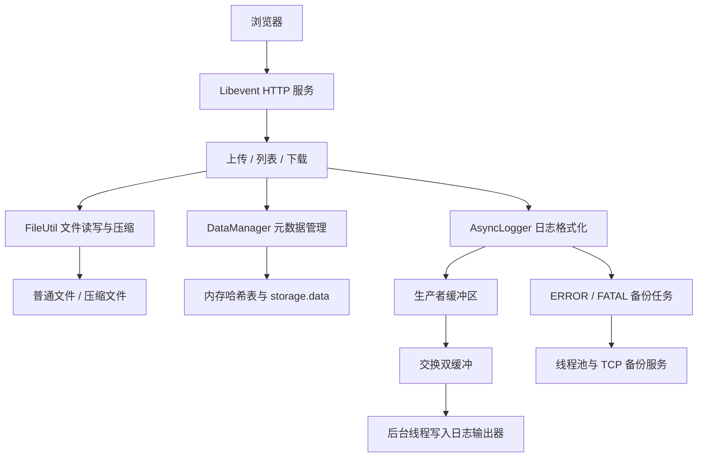

# 基于异步日志的轻量级文件存储服务


项目基于程序员 Carl / 代码随想录的学习项目整理，保留原项目的 [MIT 许可证](LICENSE)及版权声明。个人学习、分析与后续改进建立在原实现之上。

## 1. 项目定位与功能

项目由文件存储服务和异步日志系统组成。文件存储提供具体业务场景，日志系统记录请求处理和异常信息，两部分结合起来学习一个小型 C++ 服务的完整流程。

| 模块 | 当前实现 | 需要明确的边界 |
| --- | --- | --- |
| Web 页面 | 文件上传、列表展示、下载 | 无用户登录、权限隔离和文件删除接口 |
| 普通存储 | 保存文件原始内容 | 上传时将整个请求体复制到内存 |
| 深度存储 | 使用 bundle 压缩保存，下载时解压 | 用户手动选择，不是自动冷热分层 |
| 元数据管理 | 哈希表查询、读写锁保护、JSON 持久化及启动加载 | 不是数据库事务，也没有崩溃恢复保证 |
| 异步日志 | 双缓冲、后台消费、标准输出/文件/滚动文件输出 | 默认固定缓冲模式在空间不足时会等待 |
| 重要日志备份 | ERROR、FATAL 日志通过线程池提交 TCP 备份任务 | 不等于可靠投递或日志零丢失 |
| 下载续传相关逻辑 | 生成 ETag、检查 If-Range、设置相关响应头 | 未解析 Range，暂不具备完整断点续传能力 |

技术栈：C++17、Linux、Libevent、JsonCpp、bundle、TCP Socket、STL、互斥锁、条件变量及 POSIX 读写锁。

## 2. 系统结构



当前 HTTP 服务由一个线程运行事件循环，上传写盘、压缩、解压等工作直接在请求回调中执行。日志写盘使用独立后台线程，线程池用于重要日志备份任务。因此，日志异步化并不意味着整个文件服务都已经异步化。

## 3. 代码导航与阅读顺序

```text
.
├── log_system/
│   ├── examples/test.cpp          # 日志示例
│   └── logs_code/
│       ├── MyLog.hpp              # 对外日志接口
│       ├── AsyncLogger.hpp        # 日志器与构建器
│       ├── AsyncWorker.hpp        # 后台消费与线程同步
│       ├── AsyncBuffer.hpp        # 缓冲区操作
│       ├── LogFlush.hpp           # 日志输出策略
│       ├── Manager.hpp            # 日志器管理
│       ├── ThreadPoll.hpp         # 线程池（文件名沿用源码）
│       ├── config.conf            # 日志配置
│       └── backlog/               # TCP 日志备份收发端
├── src/
│   ├── server/
│   │   ├── Test.cpp               # 服务端启动入口
│   │   ├── Service.hpp            # HTTP 路由及请求处理
│   │   ├── DataManager.hpp        # 文件元数据与持久化
│   │   ├── Config.hpp             # 服务配置读取
│   │   ├── Util.hpp               # 文件、JSON、压缩工具
│   │   ├── Storage.conf           # 存储服务配置
│   │   ├── index.html             # 浏览器页面模板
│   │   └── Makefile
│   └── client/                    # 目录扫描上传客户端代码
└── LICENSE
```

建议先阅读 `src/server/Test.cpp`，了解日志初始化、元数据加载与 HTTP 服务启动顺序；再沿着 `Service.hpp` 跟踪一次上传和下载；最后深入日志系统中的 `AsyncLogger → AsyncWorker → LogFlush`。

`src/client` 可作为扩展阅读：它扫描本地目录并判断文件是否需要上传。但其 FileName 请求头直接使用原文件名，与服务端要求 Base64 编码的约定不一致，联调前需要统一协议。本文优先使用浏览器或 curl 演示。

## 4. 我对核心流程的理解

### 4.1 文件上传：文件内容和元数据是两条存储路径

1. 浏览器向 `/upload` 发送请求，正文是文件二进制内容。
2. `FileName` 请求头携带 Base64 编码后的文件名，`StorageType` 指定 `low` 或 `deep`。
3. 服务端读取请求体：普通模式直接写入 `low_storage`，深度模式压缩后写入 `deep_storage`。
4. 创建 `StorageInfo`，记录文件路径、大小、时间和下载 URL。
5. `DataManager` 更新内存哈希表，将元数据全量序列化到 `storage.data`。

这里需要理解的是：文件写入成功和元数据保存成功是两个独立步骤。目前它们没有事务保护，异常时可能出现文件已经存在、索引却未更新的情况。后续需要完善错误返回、失败清理与重启后的数据核对。

### 4.2 文件下载：普通文件与压缩文件的处理不同

下载请求通过 URL 查找元数据。普通文件直接打开；深度存储文件先解压到普通存储目录，再通过 `evbuffer_add_file` 添加到 HTTP 输出缓冲区，发送响应后删除解压文件。

压缩存储体现了磁盘空间与 CPU、下载延迟之间的取舍。当前压缩和解压都需要将内容读入内存，大文件会增加内存压力；解压文件使用原文件名，也存在与普通文件重名的风险。更合理的改进是使用独立临时目录和唯一文件名。

源码虽然设置了 `Accept-Ranges` 和 ETag，并在 If-Range 匹配时返回 206，但仍然从偏移 0 发送整个文件，未解析 Range，也未生成 Content-Range。因此，完整断点续传属于待完成项。

### 4.3 异步日志：缩短业务线程等待磁盘的时间

业务线程完成日志格式化后，将数据写入生产者缓冲区。后台线程收到通知，在锁内交换生产者与消费者缓冲区，随后释放锁，在锁外执行输出操作。

双缓冲的价值在于让后台写盘与业务继续写入缓冲区尽可能重叠，避免将慢速文件 I/O 放在共享缓冲区的临界区中。它没有消除格式化、内存复制和加锁开销，也不能保证业务线程永不阻塞。

当前默认采用固定容量模式，空间不足时生产者通过条件变量等待；另一种模式允许缓冲区增长。前者需要考虑单条超大日志和等待策略，后者需要考虑内存上限。退出时如何停止接收、唤醒等待线程并排空日志，也是需要进一步验证的部分。

### 4.4 元数据管理：读写锁解决的是内存访问问题

`DataManager` 使用 `unordered_map`，以下载 URL 为键组织元数据。查询使用读锁，插入和更新使用写锁；启动时从 JSON 文件恢复索引。

读写锁保护了内存表，但持久化发生在更新解锁之后。如果未来引入多个业务线程，多个全量快照可能交错写入，不能直接认为磁盘状态也具备相同的一致性保证。

## 5. 本地构建与体验

### 环境与依赖

需要 Linux、支持 C++17 的 g++、make，以及 JsonCpp、Libevent、bundle 的头文件和可链接库。现有 Makefile 还链接 `pthread` 和 `stdc++fs`。

仓库中有 `bundle.h`，但没有完整的 bundle 库构建脚本。构建前需确保匹配的 `libbundle` 已安装到链接器可搜索的位置；若提示 `cannot find -lbundle`，需要先补齐该依赖。本文未重新安装依赖或执行运行测试，不把环境准备步骤视为已经验证完成。

### 启动服务

从仓库根目录执行：

```bash
cd src/server
make
./test
```

需在 `src/server` 目录启动：服务配置、页面模板和日志配置均使用相对路径。`test` 是服务程序名称，不是自动化测试套件。

默认浏览器访问 `http://127.0.0.1:8081/`，选择一个非空文件和存储类型即可体验上传、列表与下载。

| Storage.conf 配置项 | 默认值 | 用途 |
| --- | --- | --- |
| server_port | 8081 | HTTP 监听端口 |
| server_ip | 127.0.0.1 | 页面生成的后端请求地址 |
| download_prefix | /download/ | 元数据中的下载 URL 前缀 |
| low_storage_dir | ./low_storage/ | 普通文件目录 |
| deep_storage_dir | ./deep_storage/ | 压缩文件目录 |
| bundle_format | 4 | 传给 bundle 的压缩格式参数 |
| storage_info | ./storage.data | 元数据文件 |

当前监听地址在代码中固定为 `0.0.0.0`，并不受 `server_ip` 限制；下载路由判断也写死了 `/download/`，调整 URL 前缀时需要同步修改路由。使用默认配置最便于复现。

日志配置位于 `log_system/logs_code/config.conf`，包括缓冲区大小、增长参数、刷盘策略、备份地址和线程数。服务入口使用滚动文件输出器，滚动阈值设为 1 MiB，日志写入运行目录下的 `logfile/`。

如需体验重要日志备份，在另一个终端从仓库根目录执行：

```bash
cd log_system/logs_code/backlog
g++ -std=c++17 -pthread ServerBackupLog.cpp -o ServerBackupLog
./ServerBackupLog 8080
```

端口需与日志配置的 `backup_port` 一致。只有 ERROR、FATAL 日志会触发备份任务，普通上传成功日志不触发该分支。

注意：现有 `make clean` 会同时删除上传目录、日志目录和 `storage.data`，不只是清理编译产物。

### 最小手工验收

服务启动后，可在另一个终端执行以下命令。示例使用普通存储，FileName 是 `readme-demo.txt` 的 Base64 编码。

```bash
printf 'hello cloud storage\n' > /tmp/readme-demo.txt
curl --fail -X POST http://127.0.0.1:8081/upload \
  -H 'FileName: cmVhZG1lLWRlbW8udHh0' \
  -H 'StorageType: low' \
  --data-binary @/tmp/readme-demo.txt
curl --fail http://127.0.0.1:8081/download/readme-demo.txt \
  -o /tmp/readme-demo.download.txt
cmp /tmp/readme-demo.txt /tmp/readme-demo.download.txt
```

`cmp` 无输出且退出码为 0 表示内容一致。还应分别验证深度存储、服务重启后列表恢复以及异常输入。测试两种存储类型时使用不同文件名，避免当前按文件名生成 URL 导致索引覆盖。以上是验收步骤，不是已执行的测试报告。

## 6. 当前不足与个人改进计划

我希望后续改进都能形成“问题复现 → 原因分析 → 代码修改 → 验证结果”的记录，而不只是增加功能名称。

| 优先级 | 当前问题 | 改进方向与验收标准 |
| --- | --- | --- |
| P0 | 上传缺少必要请求头检查，文件名直接参与路径拼接 | 校验请求头、文件名和大小；异常请求返回明确错误且不能写出存储目录 |
| P0 | 下载查询失败未及时处理，部分错误响应后仍继续执行 | 统一错误返回；资源不存在只返回一次 404 |
| P0 | 解压文件可能覆盖同名普通文件 | 使用独立临时目录和唯一标识；验证同名文件互不影响 |
| P1 | 断点续传只有部分框架 | 解析单区间 Range，补齐 206/416 与 Content-Range，验证分段拼接结果 |
| P1 | 元数据全量覆盖写入缺少原子替换 | 临时文件写入后替换，串行化持久化；验证失败与重启行为 |
| P1 | 时间字段和工具返回值存在问题 | 修正 StorageInfo 的访问/修改时间赋值颠倒，以及 JSON 解析成功仍返回 false 等问题 |
| P1 | 日志超大消息、停止和排空行为缺少验证 | 明确缓冲区满与关闭策略；覆盖等待中的生产者、重复停止和残留日志 |
| P2 | 压缩与磁盘操作阻塞事件循环 | 评估将耗时任务移出回调，明确请求对象生命周期和线程间结果交接 |
| P2 | 缺少性能证据 | 记录环境、文件大小、并发数、耗时、CPU 和内存，再比较修改前后结果 |

上述项目均为后续计划，本次仅整理文档，没有完成这些代码改进。

## 7. 面向秋招的项目表达

### 一分钟介绍思路

> 这是我基于开源学习代码研究的 C++ 文件存储项目，包含浏览器上传下载、普通与压缩存储，以及异步日志系统。我主要围绕请求处理流程和日志生产消费模型理解它：存储服务使用 Libevent 处理 HTTP 请求，元数据通过哈希表管理并保存为 JSON；日志系统通过双缓冲和后台线程处理落盘，重要日志另行提交 TCP 备份任务。阅读源码时，我也发现完整断点续传、文件与元数据一致性、日志退出排空等方面还有不足，它们是后续改进的重点。

这段介绍应根据自己的实际学习进度调整。只有能对应到代码、调试过程和验证记录的内容，才适合写成个人完成项。

### 简历描述参考

**项目名称：基于异步日志的轻量级文件存储服务（C++ 学习实践）**

- 基于开源项目学习 Libevent HTTP 服务，梳理文件上传、列表展示、普通存储及压缩存储的处理流程。
- 分析互斥锁、条件变量与双缓冲实现的日志生产消费模型，理解后台落盘、文件滚动和重要日志备份机制。
- 梳理元数据读写锁与 JSON 持久化流程，识别 Range 处理不完整、持久化一致性等问题并制定改进方案。

完成实际修改后，再将相关条目改为“修复了什么、采用什么方案、如何验证”。没有压测记录时，不填写 QPS、延迟降低比例或日志吞吐量；没有相应实现时，不使用“分布式存储”“高可用”“完整断点续传”等描述。

### 面试前需要能解释的问题

| 问题 | 结合本项目的回答重点 |
| --- | --- |
| 为什么使用异步日志？ | 将主要落盘工作移出业务线程，同时说明格式化、加锁与缓冲区等待仍有成本 |
| 双缓冲为什么要交换后解锁？ | 缩短临界区，让业务写缓冲与后台 I/O 尽可能并行 |
| 条件变量为什么带谓词？ | 等待的是状态变化，唤醒后必须重新检查条件 |
| 线程池处理了什么？ | 当前处理重要日志备份，HTTP 文件操作仍在事件回调中 |
| 压缩存储有什么代价？ | 节省空间需要付出 CPU、内存和解压延迟，压缩效果也依赖文件类型 |
| 读写锁能否保证数据不丢？ | 它保护内存访问，不等于文件持久化、原子提交或断电恢复 |
| 返回 206 就是断点续传吗？ | 还需正确解析区间、设置响应头并发送对应字节，当前实现尚不完整 |
| 项目中哪些是自己的工作？ | 区分原始实现、个人理解、实际修改及测试证据 |

我希望最终能够展示的不只是一个可运行的页面，而是对代码执行路径、并发边界、失败处理和设计取舍的理解，并用后续提交记录证明自己的改进过程。
