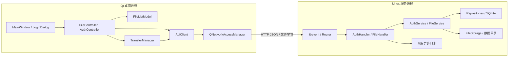

# 14：Qt 与 C++ 存储服务的接口架构参考

> 2026-10-27 数据库选型更新为 MySQL，旧 SQLite 相关实现细节不再作为当前选型。HTTP 分层原则保留；MySQL 接线和未实现状态见 [18](18-MySQL接入框架与挖空练习.md)，本篇拟定的认证端点仍不代表已实现。

日期：2026-10-21。用途：可以按顺序实现、联调和练习的设计基线。

建议沿用现有 `Client/` 的 Qt Widgets 工程，通过 Qt Network 调用 Linux/libevent 服务。两端以 HTTP 契约连接，分别构建和部署；Qt 不直接访问服务器目录、`DataManager` 或数据库。先完成旧协议的真实传输，再建立 `/api/v1` 文件接口，最后接入认证与用户隔离。

## 1. 检查范围与完成状态

本次读取了所引用聊天的可用内容，其中只有原始架构设计诉求，没有附带可下载项目。本环境是 Windows，未找到所指 `/mnt/data/AsynLogSystem-CloudStorage-main.zip`，因此**本篇依据当前本地同名仓库，未核对 ZIP 与仓库是否一致**。如果 ZIP 是另一版本，应重新核对本篇的“现有实现”表，不能据此断言 ZIP 中也有相同代码。

检查基线：仓库 HEAD `750a1103b0d54e0c42424b3ac3988a01166677a0`，加上工作区当前内容；检查时 `Client/mainwindow.cpp`、`Client/mainwindow.h` 已有用户改动，本次没有覆盖。构建目录不作为协议或源码能力的证据。

本次交付设计和独立练习示例，**没有把新 API、账户、SQLite 或安全迁移实现进现有服务**。下文严格区分：

- **现有**：可以在指定源码函数找到的行为。
- **拟定**：建议两端以后共同实现的接口与规则。
- **示例**：独立于正式客户端的参考代码，不代表主工程已经集成。

本篇细化 [13：Qt 客户端主线升级实施方案](13-Qt客户端主线升级实施方案.md)。13 中“尚未创建客户端”及环境描述是当时状态；当前已经有 `Client/`、连接测试和本机 Qt 6.8.3 Kit。不要重新建立只在大小写上有区别的 `client/` 目录，Windows 上会冲突。

## 2. 先把现有系统认准

### 2.1 模块与事实依据

下列行号为本次检查时的行号，函数名是后续查找的稳定锚点。

| 位置 | 实际职责与限制 | 对本设计的影响 |
|---|---|---|
| [Client/mainwindow.cpp](../../Client/mainwindow.cpp)，`onTestConnectionClicked` | 校验服务器 origin、请求根路径，显示连接结果 | 保留已有窗口；后续把健康检查改到新 health API |
| [Client/ApiClient.cpp](../../Client/ApiClient.cpp)，`testConnection` | `QNetworkAccessManager::get`、5 秒计时取消、`finished` 通知、`deleteLater` | 已有异步网络基础；尚无上传下载、认证和列表模型 |
| [Client/CMakeLists.txt](../../Client/CMakeLists.txt)，12–13、75–79 行 | 前半选择 Qt5/Qt6，末尾又强制 Qt6 Widgets/Network | 实际建议统一 Qt6，避免宣称支持 Qt5 |
| [src/server/Test.cpp](../../src/server/Test.cpp)，`main`、`log_system_module_init` | 日志初始化 → `new DataManager` 启动加载 → `thread t1(service_module)` → join | HTTP 事件循环在 t1；主线程等待；日志另有消费及备份线程 |
| [src/server/Service.hpp](../../src/server/Service.hpp)，89–134 行 `RunModule` | 一个 event_base，generic callback；监听写死 `0.0.0.0` | `server_ip=127.0.0.1` 不是监听隔离；服务仍可能暴露给局域网 |
| 同上，143–175 行 `GenHandler` | URL 解码后按子串 `/download/`、精确 `/upload`、`/` 分发 | 要收紧方法/路径匹配，不能把 query 或子串当路由规则 |
| 同上，207–287 行 `ValidateUploadRequest`、`ReplyUploadError` | POST、非空体、≤1MiB、FileName/StorageType 校验已存在 | 不要照旧 README 待办重复添加“完全没有校验”的补丁 |
| 同上，289–363 行 `Upload` | body 整体复制到 string，写文件/压缩，创建索引，200 空体 | 保留旧协议可完成第一轮联调；200 不等于持久化链路都可靠 |
| 同上，423–453 行 `ListShow` | 读取 `index.html`、嵌入文件列表，返回 HTML | Qt 列表需要新增 JSON API；不解析页面 |
| 同上，465–555 行 `Download` | URL 查索引、必要时解压，再 `evbuffer_add_file` | 现有断点逻辑不完整，且有错误响应后继续执行的风险 |
| [src/server/DataManager.hpp](../../src/server/DataManager.hpp)，8–35、93–171 行 | `StorageInfo`；URL 为 key 的 map；读写锁；JSON 全量持久化 | 没有用户、独立文件 ID、数据库事务；同名 URL 覆盖 |
| [src/server/Util.hpp](../../src/server/Util.hpp)，38–56、157–173 行 | URL 解码和文件写入工具 | 非法编码与写失败不能只依赖现有工具行为 |
| [src/client/Storage.hpp](../../src/client/Storage.hpp)，`Upload`、`RunModule` | 旧目录扫描上传器；FileName 直接发送原名 | 它不是 Qt 客户端；和服务端 Base64 文件名约定不一致 |
| [src/server/index.html](../../src/server/index.html)，185–194 行 | 浏览器把 UTF-8 文件名转 Base64，fetch 原始 body | 这是旧上传客户端正确编码的实际参照 |
| [log_system/logs_code/AsyncLogger.hpp](../../log_system/logs_code/AsyncLogger.hpp)，122–150 行 | ERROR/FATAL 提交备份后 `future.get()`；普通落盘通过 `Push` | 重要日志可能让 HTTP 回调等待备份，不能认为日志完全不阻塞 |
| [log_system/logs_code/AsyncWorker.hpp](../../log_system/logs_code/AsyncWorker.hpp)，36–58、60–98 行 | 已有 `PushFor`，但 Logger 仍调用 `Push`，固定缓冲可等待 | 复用日志但记录阻塞限制，不能把现有 `PushFor` 写成尚未实现 |

### 2.2 当前真实调用链、线程与数据流

```text
Qt GUI 线程
  MainWindow::onTestConnectionClicked
    → ApiClient::testConnection → manager_->get
    → Qt 网络完成事件 → connectionFinished → 更新 QLabel

Linux 主线程
  main → 配置检查 → log_system_module_init → DataManager::InitLoad
    → 创建 t1 → join 等待

Linux t1：唯一 HTTP 事件循环
  service_module → Service::RunModule → event_base_dispatch
    → GenHandler → Upload / ListShow / Download
      → FileUtil：磁盘读写、压缩/解压（仍在 t1）
      → DataManager：内存 map + storage.data（仍在 t1）
      → Logger：格式化、提交；某些路径会等待

日志消费线程：AsyncWorker::ThreadEntry → RealFlush → 日志输出器
备份线程池：执行 ERROR/FATAL 的 TCP 备份任务
```

现有上传数据为：网络接收进入 libevent input evbuffer → `evbuffer_copyout` 复制到 `std::string content` → `ofstream` 写文件，deep 再产生压缩 string → 写索引 map → 全表 JSON string → 写 `storage.data` → HTTP 200。至少同时存在接收缓冲和应用层正文副本；压缩/JSON 另有内存开销。`ValidateUploadRequest` 的大小检查在请求进入业务回调时才执行，并不单独保证接收阶段的内存上限。

现有下载用文件描述符加入 evbuffer，不应简单写成“下载也先整文件 readAll”。deep 的读取和解压确实需要完整内容。`evbuffer_add_file` 的底层发送策略依平台和配置而异，本次不把它宣称为已测得的零拷贝。

### 2.3 迁移前必须辨认的具体风险

| 优先级 | 源码证据 | 建议最小修复与验收 |
|---|---|---|
| P0 | `FileUtil::SetContent` 写失败只 close，末尾仍 true；close 后状态未检查 | 写/flush/close 都能传出失败；用受控失败注入验证响应不是 200 |
| P0 | `DataManager::Storage` 在 SetContent 失败后仍 true；Upload 忽略 NewStorageInfo/Insert 返回值 | 错误贯穿调用链；无法保存索引时不能报告上传完成 |
| P0 | Download 忽略 GetOneByURL 的 bool，`StorageInfo info` 的标量字段未初始化；493/499 行回复后没有 return | 查不到立即且仅一次 404；各错误分支结束；验证不存在资源不崩溃、不再次回复 |
| P0 | deep 解压到 `low_storage/原名`，结束 remove | 拒绝覆盖现有普通文件；改独立临时目录、唯一键、失败清理；首轮只用 low |
| P1 | `table_[info.url_] = info`；URL 仅含文件名 | low/deep 同名索引冲突，同目录同名内容被覆盖；新接口用服务器文件 ID |
| P1 | `StorageInfo::NewStorageInfo` 的 mtime/atime 赋值对调；deep fsize 来自压缩文件 | 不把 mtime 直接当上传时间；v1 单独记录 created_at 与原始字节数 |
| P1 | `UrlDecode` 对截断 `%` 使用 assert；FromHex 接受超出 A–F 的字母 | 新 Router 严格验证 percent encoding，错误返回 400，不让输入触发 assert |
| P1 | Download 只比较 If-Range，匹配就 206；无 Range 解析、Content-Range | 一期不发送 Range/If-Range；新 API 返回完整 200，不宣传续传 |
| P1 | GenHandler 通过 `find` 匹配下载；ListShow/Download 没有对应方法检查 | 按解析 path 精确/分段匹配；错误方法 405 + Allow |
| P1 | HTML 中直接嵌入文件名与 URL，未见转义 | 若保留页面需 HTML/属性上下文转义；Qt 元数据按纯文本显示 |
| P1 | `Storage()` 解锁后全量写 JSON | 当前一个 HTTP 线程不能等同于已经有多业务线程竞争；以后加线程会有快照交错写风险 |

`Util.hpp::JsonUtil::UnSerialize` 当前成功返回 true；不要按旧 README 的历史描述再声称“成功仍 false”。`InitLoad` 仍忽略解析结果，加载大小使用 asInt，应该单独修复并验证损坏索引处理。

## 3. 两端共同遵守的边界



| 模块 | 输入/输出与责任 | 不应承担 |
|---|---|---|
| MainWindow、LoginDialog | 用户操作、对话框；显示模型和任务状态 | URL 拼接、HTTP 判错、SQL |
| FileController | 刷新列表、发起上传下载、把结果更新到 Model | 自己保存文件内容 |
| FileListModel | `QAbstractTableModel`，保存 FileDto 列表 | 请求服务器、保存 token |
| TransferManager | task_id、队列、最多 2 个活动任务、取消/重试策略 | 混淆进度完成和服务确认 |
| ApiClient | 基地址、token、请求创建、JSON/HTTP 解析、传输设备寿命 | 持有 UI 控件；访问服务器磁盘 |
| Router | method+path、参数、404/405、协议边界异常处理 | 数据库、压缩、用户业务 |
| Handler | 校验请求格式 → 调用业务 → 一次响应 | 信任客户端 owner_id |
| AuthService | 注册、登录、会话验证/注销；返回身份 | 文件目录拼接 |
| FileService | 权限检查、文件保存与记录状态转换 | 返回 evbuffer 或 GUI 类型 |
| FileRepository / UserRepository | 参数绑定 SQL、索引与事务 | 接触网络 reply |
| FileStorage | 服务器生成键、临时写入、发布、打开只读 fd、清理 | 从显示文件名决定真实路径 |

依赖方向：UI → 应用层 → 网络适配；HTTP → 业务 → 持久化。两端只共享“协议定义和测试样例”，不共享 QObject、StorageInfo、裸路径或进程内指针。现有 `StorageInfo` 是内部存储结构，不能原样序列化成公共 DTO。

建议目录按需求逐步形成：

```text
Client/                            # 沿用现有目录与 CMake target
  mainwindow.* / main.cpp
  network/ApiClient.{hpp,cpp}       # 从当前 ApiClient 逐步迁入
  model/FileDto.hpp / FileListModel.{hpp,cpp}
  controller/{FileController,AuthController}.{hpp,cpp}
  transfer/TransferManager.{hpp,cpp}
  ui/LoginDialog.{hpp,cpp}
src/server/
  Test.cpp / Service.hpp            # 先保留启动与 legacy
  http/{Router,RequestContext,JsonResponse}.{hpp,cpp}
  handlers/{FileHandler,AuthHandler}.{hpp,cpp}
  services/{FileService,AuthService}.{hpp,cpp}
  repositories/{Database,FileRepository,UserRepository,SessionRepository}.{hpp,cpp}
  storage/FileStorage.{hpp,cpp}
docs/api-v1.md                     # 开始实现 v1 时抽取本篇第 5 节为唯一接口基线
tests/{server,client}/
```

不要同时保留两套同名 ApiClient 实现，也不要第一天建齐所有空类。现有 Config.hpp 在头文件定义静态成员与全局 `Config_File`，MyLog.hpp 在头文件定义非 inline 函数；拆多 cpp 时要同步改为单一定义或合适的 C++17 inline，避免链接阶段多重定义。新模块尽量不包含整个旧 Util/日志实现；用窄接口注入需要的能力。

## 4. 第一轮：保持现有 legacy 协议

以下是**当前服务实际可识别的请求**，不是新 API。

| 操作 | 请求 | 现有响应 | Qt 处理 |
|---|---|---|---|
| 连接探测 | `GET /` | 200，`text/html;charset=utf-8` | 只能证明某个 HTTP 页面可达，不能证明协议版本、认证或写盘能力 |
| 上传 | `POST /upload`；body 原始文件字节；`FileName: Base64(UTF-8文件名)`；`StorageType: low/deep` | 成功 200，空 body；校验失败 400；错误方法 405 + Allow: POST；超限 413；部分内部失败 500 | 判断状态码与网络错误，不解析成功 JSON；首轮固定 low |
| 下载 | `GET /download/{编码后的文件名}`，默认配置 | 正常 200，二进制；旧代码某些 If-Range 情形 206；错误返回目前不可靠 | 不发 Range/If-Range；仅把完整 200 视为下载成功 |

上传文件必须 **1～1,048,576 字节**。Content-Type 发 `application/octet-stream`，虽然旧校验没有检查它。不要发 `multipart/form-data`，否则服务会把 multipart 边界一并保存。Base64 只是头部编码，不是加密；正文不进行 Base64。

本地 Linux 测试命令（对运行中的现有服务；使用独立、可清理的实验数据）：

```bash
# 服务端需在 src/server 工作目录运行，依赖已经安装。
cd src/server
make gdb_test
./gdb_test
```

另开终端：

```bash
printf 'hello Qt storage\n' > /tmp/qt-bridge-demo.txt
curl --fail-with-body -i http://127.0.0.1:8081/upload \
  -H 'Content-Type: application/octet-stream' \
  -H 'FileName: cXQtYnJpZGdlLWRlbW8udHh0' \
  -H 'StorageType: low' --data-binary @/tmp/qt-bridge-demo.txt
curl --fail-with-body http://127.0.0.1:8081/download/qt-bridge-demo.txt \
  -o /tmp/qt-bridge-demo.download.txt
sha256sum /tmp/qt-bridge-demo.txt /tmp/qt-bridge-demo.download.txt
```

预期是上传 HTTP 200 和两个相同摘要；这只是验收步骤，不是本次已通过的真实服务测试。旧 `make clean` 会删除上传目录、日志和 storage.data；练习不要用它清理编译产物。

直接可练习的 [Qt 参考工程](examples/qt-http-bridge/README.md) 包含上传、下载、进度、取消、总超时以及 QSaveFile 保存。它固定 low、只面向 legacy，放在 docs 示例目录，不修改正式 UI。上传 200 仅称“服务端确认”，还应下载比对字节，不能掩盖上节所述现有写盘错误。

## 5. 第二轮：拟定 `/api/v1` 契约

**本节全部为新设计，当前服务尚未提供这些路径。** 一旦两端开工，把本节抽取成 docs/api-v1.md，变更先改契约与测试样例再改两端。建议实现第一版时冻结以下规则。

### 5.1 公共规则

| 项目 | 约定 |
|---|---|
| 基地址 | `https://storage.example.com` 或本地开发 `http://127.0.0.1:8081`；客户端仅配置 origin，API 固定 `/api/v1` |
| 元数据 | 请求/响应 UTF-8 JSON，`Content-Type: application/json`；大小上限 16KiB 用于账户请求 |
| 文件传输 | `application/octet-stream`；一期不做 multipart、压缩协商、分片或续传 |
| 身份 | `Authorization: Bearer <opaque-token>`，由服务端解析得到 user_id |
| 成功 JSON | `{"data": ... , "request_id":"r_..."}`；204 没有响应体；二进制响应不包 JSON |
| 错误 JSON | `{"error":{"code":"...","message":"..."},"request_id":"r_..."}`；不能把 error 放在 HTTP 200 |
| 关联 ID | 服务端生成 `r_` + 32 位小写 hex；所有应用响应有 `X-Request-ID`，JSON 中相同；日志记录它 |
| ID | 文件 `f_`、用户 `u_` + 32 位小写 hex；不透明字符串，无路径含义；ID 随机不代替权限检查 |
| 时间/大小 | 时间为 UTC ISO 8601，例如 `2026-10-21T02:00:00Z`；size 为整数原始字节数，一期限额内无精度歧义 |
| 文件名 | Base64 标准字母表 + 标准 padding；解码后有效 UTF-8，1～255 字节；禁止 `.`, `..`、`/`、`\`、NUL、C0/DEL 控制字符；不自动 trim |
| 同名文件 | 每次成功上传生成新 ID，可有相同显示名；无覆盖、重命名和删除接口 |
| 缓存/跳转 | 认证与用户文件响应 `Cache-Control: no-store`；API 不返回重定向；客户端拒绝自动跳转 |
| 空文件 | 一期沿用拒绝空 body，400 `EMPTY_FILE`；以后放开需要两端和测试一起升级 |

文件名是显示信息；真实路径只能由服务器 storage_key 生成。为便于桌面使用，Qt 下载应让用户确认保存路径，并处理 Windows 保留文件名、非法字符、已有文件覆盖确认；不要自动使用服务端名称创建任意本地路径。

### 5.2 路由表

| 方法/路径 | 请求 | 成功结果 | 关键错误 |
|---|---|---|---|
| GET `/api/v1/health` | 无认证 | 200，service、api_version、limits | 正常服务启动后可用；不返回配置/内部目录 |
| POST `/api/v1/auth/register` | JSON username/password | 201，UserDto；不自动登录 | 400、409 `USERNAME_TAKEN`、429、503 |
| POST `/api/v1/auth/login` | JSON username/password | 200，token、expires_at、user | 401 `INVALID_CREDENTIALS`、429、503 |
| POST `/api/v1/auth/logout` | Bearer，空 body | 204；删除当前会话 | 无效/过期会话 401，Qt 本地仍完成退出 |
| GET `/api/v1/me` | Bearer | 200，UserDto | 401 |
| GET `/api/v1/files?limit=50&offset=0` | Bearer | 200，items、total、limit、offset | 400、401、503 |
| POST `/api/v1/files` | Bearer；FileName Base64；原始文件正文 | 201，FileDto；Location 指向 content 路径 | 400、401、413、415、500、503 |
| GET `/api/v1/files/{id}/content` | Bearer | 200，完整二进制 | 401、404、500、503 |

上传 v1 不需要 StorageType；新文件固定 low，客户端去掉这个 legacy 头。未知业务字段不被采纳；不允许 owner_id、storage_path、storage_key 等客户端字段影响身份或落盘位置。

只有路径和方法都匹配才进入 Handler。不存在路径 404；存在路径的方法错误 405，返回 Allow，例如文件集合为 `GET, POST`，下载为 `GET`。一期不声明 HEAD 支持，HEAD 方法错误响应也不能发送正文。查询参数只对列表定义，重复/未知参数和非法整型均为 400。分页 limit 为 1～100，offset 为非负整数且设实现上限（建议 100000），按 `created_at DESC, id DESC`；total 只统计当前用户 ready 文件。同次列表的计数与 items 在一次读事务读取；跨次翻页期间新上传可能导致移位，不承诺快照分页。

Range 一期忽略并返回完整 200，不发 `Accept-Ranges: bytes`，Qt 不发送 Range。以后做续传再加入真正的单区间解析、合法 206/416 和 Content-Range；[HTTP 范围请求规则](https://www.rfc-editor.org/rfc/rfc9110.html#section-14)约束的是响应头和对应字节，不能只改状态码。

### 5.3 具体请求/响应样例

健康检查：

```http
GET /api/v1/health HTTP/1.1
Host: 127.0.0.1:8081
Accept: application/json
```

```json
{
  "data": {
    "service": "cloud-storage",
    "api_version": "v1",
    "limits": {"max_upload_bytes": 1048576, "allow_empty_file": false}
  },
  "request_id": "r_0123456789abcdef0123456789abcdef"
}
```

Qt 校验 service/version/字段类型后再显示“接口兼容”。health 表示已启动且能分发请求；数据库无法初始化时应启动失败，不伪造健康。它不能证明下一次写盘一定成功。

注册/登录使用相同字段（以下口令仅为格式示例）：

```json
{"username":"alice","password":"example-passphrase-123"}
```

username 归一为小写 ASCII，匹配 `[a-z0-9_]{3,32}`；password 不 trim、不自动 Unicode 归一化，明确限制为 12～128 个 UTF-8 字节，服务端最终校验。登录不存在用户与密码错误均用相同 401 结构，避免透露账户是否存在。

登录成功：

```json
{
  "data": {
    "token": "<32个随机字节的base64url编码，无padding，共43字符>",
    "expires_at": "2026-10-22T02:00:00Z",
    "user": {"id":"u_0123456789abcdef0123456789abcdef","username":"alice"}
  },
  "request_id":"r_1123456789abcdef0123456789abcdef"
}
```

固定会话时长建议 24 小时，由服务配置控制，不滑动续期；到期返回 401，Qt 重新登录。上面的 token 是说明性占位符，不是真实 token。注册和 me 的 data 直接为 UserDto；UserDto 只有 id、username。

上传示例（省略 Content-Length，实际由 HTTP 客户端计算）：

```http
POST /api/v1/files HTTP/1.1
Host: 127.0.0.1:8081
Authorization: Bearer <token>
Content-Type: application/octet-stream
FileName: bm90ZXMudHh0

hello
```

FileName 对应 `notes.txt`。服务端应校验 Content-Type、实际 body 长度、严格 Base64 与解码后的 UTF-8 文件名；HTTP 解析器负责非法消息 framing，客户端已知长度时显式发送正确 Content-Length。不能只相信该头绕过实际长度检查。

成功为 HTTP 201、`Location: /api/v1/files/f_0123456789abcdef0123456789abcdef/content`：

```json
{
  "data": {
    "id":"f_0123456789abcdef0123456789abcdef",
    "name":"notes.txt",
    "size":6,
    "created_at":"2026-10-21T02:00:00Z"
  },
  "request_id":"r_2123456789abcdef0123456789abcdef"
}
```

列表成功的 data 形状：

```json
{
  "items":[{
    "id":"f_0123456789abcdef0123456789abcdef",
    "name":"notes.txt","size":6,"created_at":"2026-10-21T02:00:00Z"
  }],
  "total":1,"limit":50,"offset":0
}
```

下载成功头部：`Content-Type: application/octet-stream`、正确的 Content-Length、`Cache-Control: no-store`、X-Request-ID；可固定 `Content-Disposition: attachment`，Qt 用列表名称作为保存建议，不依赖不安全的头部拼接。不存在文件与他人文件统一 404 `FILE_NOT_FOUND`；已认证的自身 ready 文件实际丢失属于内部一致性错误，500 并记日志/对账。

### 5.4 错误与客户端决策

```http
HTTP/1.1 413 Payload Too Large
Content-Type: application/json
X-Request-ID: r_3123456789abcdef0123456789abcdef
Cache-Control: no-store
```

```json
{
  "error":{"code":"FILE_TOO_LARGE","message":"文件超过 1 MiB 限制"},
  "request_id":"r_3123456789abcdef0123456789abcdef"
}
```

| 情况 | HTTP / code | Qt 行为 |
|---|---|---|
| 字段/编码/分页错误 | 400 `INVALID_ARGUMENT`、`INVALID_FILENAME`、`EMPTY_FILE` | 显示可理解提示，不重试相同输入 |
| 缺少、无效或过期 token | 401 `UNAUTHENTICATED`；`WWW-Authenticate: Bearer` | 当前会话失效，取消任务、清空该用户模型、回登录 |
| 用户名重复 | 409 `USERNAME_TAKEN` | 提示换名 |
| 文件超限 | 413 `FILE_TOO_LARGE` | 提示上限；服务端规则为准 |
| 类型错误 | 415 `UNSUPPORTED_MEDIA_TYPE` | 检查请求构造 |
| 文件不存在/非本人 | 404 `FILE_NOT_FOUND` | 刷新列表，不泄露真实 owner |
| 限频 | 429 `RATE_LIMITED` + Retry-After | 显示等待时间，不循环登录 |
| 文件/索引写失败 | 500 `FILE_SAVE_FAILED` / `METADATA_SAVE_FAILED` | 失败；保留 request_id 便于定位 |
| 任务满、数据库忙、哈希资源不足 | 503 `SERVICE_BUSY` + Retry-After | 提示稍后；上传不自动重放 |
| 没有 HTTP 状态 | 客户端 NETWORK/TIMEOUT/CANCELLED | 与 HTTP 业务错误分开显示 |
| 200/201 但 JSON 类型或必需字段不符 | 客户端 PROTOCOL_ERROR | 不能标记业务成功；上传结果可能未知 |

Qt 的 reply->error() 对不少 HTTP 错误也不为 NoError，应先取状态和受限长度错误体，再结合网络错误分类。网关/解析器可能返回非 JSON HTML 或空体；客户端要容忍并显示 HTTP 状态，不能因 JSON 解析失败丢失主要错误。应用保证 JSON 的边界是自己的 Handler，不承诺所有传输层拒绝都带 JSON。

上传 POST 暂无幂等键。服务已保存但响应丢失时，客户端只能标记“结果未知，请刷新核对”，再次上传可能产生另一个 ID。task_id 用于本地追踪，request_id 用于单次请求关联，都不等于幂等键。先做人工重试入口；以后再设计 `(owner_id, idempotency_key)` 唯一约束、请求摘要及结果保存。

## 6. Qt 如何实现而不把逻辑堆在窗口里

### 6.1 值对象与网络接口骨架

以下为 v1 接口草图，用来划分职责；尚未实现其中方法。现有示例只实现 legacy 传输。

```cpp
struct FileDto {
    QString id;
    QString name;
    qint64 size = 0;
    QDateTime createdAt;
};

struct ApiError {
    enum class Kind { Network, Http, Protocol, LocalIo, Timeout, Cancelled };
    Kind kind;
    int httpStatus = 0;
    QString code, message, requestId;
};

class ApiClient : public QObject {
    Q_OBJECT
public:
    // 草图：每次调用都返回本地操作 ID；预检失败也通过 queued 信号报告。
    QString checkHealth();
    QString login(const QString& username, const QString& password);
    QString fetchFiles(int limit = 50, int offset = 0);
    QString upload(const QString& localPath);
    QString download(const QString& fileId, const QString& targetPath);
    void cancel(const QString& operationId);
signals:
    void filesReady(QString operationId, QList<FileDto> files, qint64 total);
    void uploadReady(QString operationId, FileDto file);
    void downloadReady(QString operationId, QString targetPath);
    void progress(QString operationId, qint64 done, qint64 total);
    void failed(QString operationId, ApiError error);
};
```

跨线程 queued connection 若传自定义值对象，需要 Q_DECLARE_METATYPE 等注册；第一版所有这些 QObject 留 GUI 线程，可避免不必要线程边界。API 持有一个 manager，构造/调用/销毁在同一线程。网络事件异步，正常小文件无需每个请求创建 QThread。上传设备必须在 reply finished 前存活，[Qt post(QIODevice*) 文档](https://doc.qt.io/qt-6/qnetworkaccessmanager.html#post)明确要求了这个生命周期。

窗口只负责类似代码（方法名对应上面的拟定接口，不是当前已存在的成员）：

```cpp
// FileController 的槽；UI 通过它发操作。
const QString id = api_->upload(localPath);
// TransferManager 使用 id 关联一条任务；不要只依赖当前选中行。
```

完整示例见 [LegacyTransfer.hpp](examples/qt-http-bridge/LegacyTransfer.hpp)、[LegacyTransfer.cpp](examples/qt-http-bridge/LegacyTransfer.cpp)。把其完成逻辑迁入正式 ApiClient 时，要改上传路径、期望状态 201、Bearer、FileDto 解析和每任务关联；下载改成文件 ID，legacy 的空体成功处理不能直接用于 v1。

### 6.2 下载与任务生命周期

下载建议：打开 QSaveFile（不启用 directWriteFallback）→ readyRead 分块读写并检查短写 → finished 读取尾部 → 校验完整 200、网络状态、已知长度 → commit。失败或取消不提交，原目标不被半文件替换。[QSaveFile 文档](https://doc.qt.io/qt-6/qsavefile.html)说明 commit 和临时文件语义；它不是整个服务器存储系统的事务。

```text
Queued → Running → AwaitingResponse → Succeeded
   └──────────────→ Failed / Cancelled / OutcomeUnknown
```

- uploadProgress 到 100% 只表示传输进度，收到合法 201 + FileDto 才标 Succeeded。
- 下载进度到 100% 后还要等磁盘 commit 成功。
- errorOccurred 用于记录，finished 是唯一完成收口，防止一条任务报两次失败。
- reply 在 finished 用 deleteLater；取消句柄用 QPointer，不能保留悬空裸指针。[QNetworkReply 文档](https://doc.qt.io/qt-6/qnetworkreply.html)也规定了该清理方式。
- 一个任务一套文件对象、状态与 reply，最多 2 个活动任务，其余 Queued；同一目标路径的并发下载应禁止。
- 窗口关闭取消或销毁所属任务；连接都提供 QObject context，回调不捕获无生命周期保护的控件指针。
- 退出账户时增加 session generation；回调携带创建时 generation，旧账户的晚到响应不能重新填入新账户列表。取消旧请求、清空队列、模型和内存 token。
- v1 客户端请求绑定 origin 和会话；切换服务器应退出并清理 token，避免把旧 token 发给新地址。
- 总超时和无数据活动超时是两种机制。已有 5 秒连接探测总期限可以保留；传输示例采用 15 秒无活动、30 秒总期限供 1MiB 开发练习，正式值可配置。

## 7. 服务端如何逐步拆解

### 7.1 第一个可接入的 health Handler

下面的代码可作为练习起点放入一个 `.cpp`；不依赖旧 DataManager。示例仅处理 health 的小固定正文，不是完整 Router，也没有接入当前服务。集成时 `arg` 指向应用上下文，保留当前接口作为显式 legacy 分支。

```cpp
#include <event2/http.h>
#include <event2/buffer.h>
#include <cstring>
#include <string>

static void ReplyHealth(evhttp_request* req, const std::string& requestId) {
    auto* headers = evhttp_request_get_output_headers(req);
    evhttp_add_header(headers, "X-Request-ID", requestId.c_str());
    evhttp_add_header(headers, "Cache-Control", "no-store");
    if (evhttp_request_get_command(req) != EVHTTP_REQ_GET) {
        evhttp_add_header(headers, "Allow", "GET");
        // 正式版统一 JsonResponse 产生 METHOD_NOT_ALLOWED 错误；HEAD 无正文。
        evhttp_send_reply(req, 405, "Method Not Allowed", nullptr);
        return;
    }
    // requestId 必须由服务端生成，不能拼接未经校验的客户端字符串。
    const std::string body =
        "{\"data\":{\"service\":\"cloud-storage\",\"api_version\":\"v1\","
        "\"limits\":{\"max_upload_bytes\":1048576,\"allow_empty_file\":false}},"
        "\"request_id\":\"" + requestId + "\"}";
    auto* output = evhttp_request_get_output_buffer(req);
    if (evbuffer_add(output, body.data(), body.size()) != 0) {
        evhttp_send_reply(req, 500, "Internal Server Error", nullptr);
        return;
    }
    evhttp_add_header(headers, "Content-Type", "application/json");
    // body 已写入 request 的 output buffer，不能把同一 buffer 再搬入自身。
    evhttp_send_reply(req, 200, "OK", nullptr);
}
```

接线要点：在 GenHandler 中先解析 path，精确匹配 `/api/v1/health` 调用上面的函数并 return；其他 legacy 行为暂时保留。不要先对整个 path 解码再用子串匹配。Router 初版只需 exact route + 一个 `{id}` 参数段；新增路径测试后再抽文件。

正式 JsonResponse 使用现有 JsonCpp 生成完整 envelope，检查序列化/缓冲错误；示例固定字符串只用于最小 health 学习。request_id 的随机实现可在认证阶段统一采用 libsodium；没有安全随机生成能力时，练习可用唯一诊断 ID，但不能把它复用为 token。

### 7.2 请求与业务边界草图

```cpp
// 声明草图：Result、AuthenticatedUser、PendingFile 等需在对应练习中定义。
// HTTP 类型仅出现在 RequestContext / Handler 层。
struct UploadCommand {
    std::string ownerId;       // 从已验证会话注入
    std::string originalName;
    std::string bytes;         // 一期 1MiB 整体接收；未来替换为流/临时文件
};

class FileService {
public:
    Result<FileDto> upload(UploadCommand command);
    Result<FilePage> list(const AuthenticatedUser&, int limit, int offset);
    Result<ReadableFile> openContent(const AuthenticatedUser&, const std::string& id);
};

// Handler 的处理顺序：
// 限流/认证 → 检查类型与实际 body → 解码/校验文件名
// → FileService::upload → 201 JsonResponse 或一次错误响应。
```

Handler/RequestContext 只在本次同步回调有效。C++ 异常不能穿过 C 回调边界；最高层捕获转换一次 500，避免记录失败又递归调用可能抛异常的日志器。开始发送二进制后若发生网络错误，终止该传输并日志记录，不能再追加 JSON 错误。

一期沿用单个事件线程，先把 1MiB low 传输正确性做好；文件和 SQLite 操作仍会阻塞该线程，必须如实描述。日志后台线程不替代文件服务执行器。使用已有 ScopeTimer 观察回调耗时：发现显著阻塞后再定向增加有界执行器。

以后异步化的交接应是：事件线程复制受限参数/登记 request token → 有界工作队列处理文件或密码哈希 → 完成队列 + 通知 fd 唤醒 event loop → 事件线程验证请求仍存在 → 回复。工作线程不直接操作 UI、evhttp_request 或同一数据库连接。需要明确断连、超时、停止、请求所有权和 exactly-once 回复；[libevent request ownership 文档](https://libevent.org/doc/http_8h.html)提供 `evhttp_request_own` 等机制，但仅调用它并不能完成线程安全设计。

## 8. 账户、权限与安全边界

1. 服务初始化 `sodium_init()`，密码使用 `crypto_pwhash_str` / `crypto_pwhash_str_verify`；保存库生成的含盐参数化字符串，不能用普通 SHA-256 存口令。[libsodium 密码哈希文档](https://doc.libsodium.org/password_hashing/default_phf)给出这组 API。参数由部署环境实测选定，失败返回 503，不能降级为弱哈希。
2. token 用 `randombytes_buf` 产生 32 字节，再 Base64URL 无 padding；数据库只存 SHA-256 token 摘要、user_id、expires_at。高熵 token 的摘要用途不同于低熵口令哈希。[随机数文档](https://doc.libsodium.org/generating_random_data)说明使用密码学安全随机源。
3. Qt 首版 token 只存内存，不保存密码，不做自动登录；将来需要记住会话才使用系统凭据库。日志不记录登录正文、Authorization、密码或完整 token。
4. 每个文件 SQL 都约束 owner：`WHERE id=? AND owner_id=? AND state='ready'`。列表、上传、下载都走相同认证入口，不接受客户端 owner_id。猜到 ID 仍不能读取他人文件。
5. 登录功能启用时，**默认禁用 `/`、`/upload`、`/download/...` 旧匿名路径和任何直通存储目录的静态映射**。如仍演示 legacy，用独立端口/进程和独立数据目录；不能让它成为访问 v1 数据的旁路。
6. 本地开发优先监听 loopback；公网部署 HTTPS 反向代理 → 仅内网/loopback HTTP 服务。Qt 校验证书，不忽略 sslErrors；客户端禁止自动跳转，防止 token 意外转发到其他地址。
7. 限制连接数、头部大小、读取期限和 body 大小。在 libevent 配置 `evhttp_set_max_body_size`，业务再检查实际长度；网关也配置 ≤1MiB 文件上限与账户小 body 上限。旧回调式实现往往在认证前就接收完整 body，因此只在 Handler 验证 token 不能解决接收阶段资源消耗。[libevent HTTP API](https://libevent.org/doc/http_8h.html)提供相应限制接口，具体可用版本需按本机头文件确认。
8. 注册/登录按来源和账户做限频，建议起点为单来源每分钟 10 次登录尝试、全局最多 2 个并行哈希任务，队列有上限；参数是练习初值。返回 429/503 + Retry-After，不在 event loop 内 sleep。使用反代转发 IP 时只信任自己配置的代理。
9. 存储目录由服务进程独占可写；拒绝符号链接替换，临时文件以独占方式创建，final key 服务器生成，rename 在同一文件系统。Base64 名称校验不能替代磁盘边界与进程权限。

哈希本身耗资源，最早的本地单用户实验可以同步调用并测出阻塞；公网认证版本需先加入资源限制和有界执行，不能把“Qt 没卡”当成服务器不会堵的证据。桌面客户端没有浏览器同源限制，通常不需为了 Qt 增加任意 `Access-Control-Allow-Origin: *`。

## 9. 数据模型与失败恢复

### 9.1 SQLite 建议结构

```sql
PRAGMA foreign_keys = ON;

CREATE TABLE users (
  id TEXT PRIMARY KEY,
  username TEXT NOT NULL UNIQUE,
  password_hash TEXT NOT NULL,
  created_at TEXT NOT NULL
);
CREATE TABLE sessions (
  token_hash BLOB PRIMARY KEY,
  user_id TEXT NOT NULL REFERENCES users(id),
  expires_at INTEGER NOT NULL
);
CREATE INDEX sessions_expiry ON sessions(expires_at);
CREATE TABLE files (
  id TEXT PRIMARY KEY,
  owner_id TEXT NOT NULL REFERENCES users(id),
  original_name TEXT NOT NULL,
  storage_key TEXT NOT NULL UNIQUE,
  size INTEGER NOT NULL CHECK(size BETWEEN 1 AND 1048576),
  created_at TEXT NOT NULL,
  state TEXT NOT NULL CHECK(state IN ('pending','ready','failed'))
);
CREATE INDEX files_owner_order ON files(owner_id, state, created_at DESC, id DESC);
PRAGMA user_version = 1;
```

schema 创建/升级用事务和明确版本，不每次启动重复 CREATE 当迁移。`PRAGMA foreign_keys=ON` 每个连接配置并检查；[SQLite 官方外键说明](https://www.sqlite.org/foreignkeys.html)明确它是连接级设置。SQL 全部参数绑定，禁止字符串拼接；设置有限 busy timeout，忙时返回可理解的 503。不要在数据库事务中执行耗时网络发送。

一期 SQLite 连接留在使用它的事件线程；以后存储工作线程只负责文件 IO，元数据仍回事件线程提交，或为每个数据库执行上下文明确连接所有权。不能因为 SQLite 支持某种线程模式就任意共享一个业务事务连接。

### 9.2 文件与记录不是一个原子资源

选择 `data-v1/storage.sqlite3`、`data-v1/objects/`、`data-v1/tmp/`，与旧目录隔离。对每个上传只分配一次 id/key，按以下顺序：

1. 认证、限额、文件名检查；插入 pending 记录并提交数据库事务。pending 不可列出/下载。
2. 独占创建唯一 tmp 文件，完整写入，检查 write/flush/close。
3. 同一文件系统内将 tmp 发布到不可覆盖的唯一 final key。
4. 数据库短事务将记录改为 ready 并提交；此时才返回 201 + FileDto。
5. 任一步失败都不报成功：清理本次拥有的 tmp/final，标记 failed；清理失败写诊断，交启动对账。不能删除其他 key 或旧用户文件。

进程重启恢复要在开放请求前执行：pending 记录无论处于 tmp 还是 final，按首版保守策略清理对应对象并标记 failed；ready 缺失对象改 failed 并报警；没有记录的对象先隔离待人工核对。不要把未完成的 pending 直接当已上传成功。对账只能处理本服务独占数据根目录内、可核对归属的文件，不扫描用户其他目录。

若第 4 步已提交而响应丢失，ready 文件保留，属于客户端结果未知；与未提交 pending 的处理不同。数据库事务保证的是数据库内部提交，不包含任意对象文件的 rename；[SQLite 原子提交文档](https://www.sqlite.org/atomiccommit.html)不能替代这套跨资源恢复。上述流程首先解决进程崩溃和可报告错误，不宣称断电零丢失；若要提升断电保证，还需同步文件/目录、SQLite journal/synchronous 策略及实际故障验证。

### 9.3 旧数据导入与回滚

先保持旧目录只读备份；新 API 只读写 SQLite + data-v1，不同时从 JSON 和 SQLite 合并列表。需要导入时再提供显式离线工具：

```text
import-legacy --manifest <storage.data备份> --owner <已存在用户ID>
              --source-root <旧数据根> --target-root <新数据根> --dry-run
```

这条是**未来工具的拟定命令，当前不存在**。实际流程先 dry-run 输出可导入/缺失/冲突/压缩失败清单，再显式执行。旧文件不自动归给第一个注册用户。为每条已解析索引分配新 ID，deep 解压到新目录，不覆盖旧 low，同名保留不同记录；比对原始内容摘要和大小，导入清单记录源记录指纹防止重复导入。

旧 URL 索引覆盖后丢失的记录不能凭空恢复；单独扫描物理目录得到的文件需用户核对，不能假定每条历史上传都可找回。旧时间字段存在对调问题，新记录写入导入时间，历史 stat 时间单独保存为来源信息或省略。

回滚是停止 v1、保留 data-v1 和数据库备份，显式启动旧服务使用原目录；不把新的多用户文件反向塞进匿名目录。二者数据不混写，也不把关闭认证作为生产回滚方案。

## 10. 构建与部署的渐进改造

当前先用 `Client/CMakeLists.txt` 构建 Qt，用 `src/server/Makefile` 构建服务。客户端统一为 Qt6 Widgets + Network、C++17，选择和 Qt 库匹配的编译器 Kit。独立示例也可验证这一点。

有实际需求后再加根 CMake：`BUILD_CLIENT`、`BUILD_SERVER`、`BUILD_TESTING`；Windows 只构建 Qt，不进入 POSIX 服务依赖。服务 target 首先保持 Test.cpp + base64.cpp，链接 Threads、libevent、JsonCpp、bundle，再逐步增加 SQLite/libsodium。bundle 仓库只有头文件及已有链接假设，必须明确它的源码来源、版本、构建/导入库路径，不能写“克隆后一定直接编译”。

配置迁移要把 Storage.conf、日志 config、index.html 与数据路径一并考虑。先维持当前工作目录兼容，再实现 `--config` 和统一数据根；不要仅把二进制移到 build 就认为能启动。删除构建产物与删除运行数据必须分开。

部署验收：客户端 Windows/服务 Linux 独立构建；服务监听和 HTTPS 入口符合预期；数据库/文件目录权限正确；日志无敏感数据；重启能恢复 ready 文件及有效会话；旧匿名入口不能访问新数据。

## 11. 分阶段练习与验收

下表是实施路线，**没有自动宣布这些功能已完成**。每阶段都有最小成果，完成当前阶段再推进；无需先重写整个日志库或引入庞大框架。

| 阶段/参考投入 | 具体改动范围 | 正常实验 | 故障/并发实验与通过条件 |
|---|---|---|---|
| A：旧协议闭环，半天～1天 | Client ApiClient/上传下载入口；SetContent、Upload、Download 必要错误链 | 1KB 文本、含 NUL 二进制、中文文件名各上传下载，摘要相同，UI 可操作 | 停服务、空文件、1MiB+1、不可写下载目录；明确失败且不覆盖旧目标；同名/深度风险记录 |
| B：健康与 Router，半天～1天 | exact route、JsonResponse、health；Qt 验证 service/version | curl health 和 Qt 连接状态一致 | 404、405、带 query、非法 `%` 编码；无崩溃、一次响应；明确 framing 层可能返回非 JSON |
| C：文件 API，2～4天 | FileDto、FileRepository、FileStorage、SQLite；QTableView 模型 | 本地专用开发身份、空 data-v1，上传列表按 ID 下载，重启恢复 | 同名文件互不覆盖；写失败不 ready；两个并发上传和刷新行为正确；仅本地演示 |
| D：认证与隔离，2～4天 | AuthService、会话、LoginDialog、owner 查询、禁旧入口 | 注册 A/B、登录、各自上传同名不同内容 | A 拿 B 的 ID 返回 404；无 token/过期/注销 401；旧匿名路径不能绕过；限频和哈希资源边界 |
| E：队列与恢复，2～3天 | TransferManager、generation、取消、pending 对账 | 选 6 个文件，最多 2 个活动任务，逐个完成 | 中途断连、服务重启、退出后晚到响应、并发同目标；终态一次，未提交下载不留下成品 |
| F：演示与工程证据，1～2天 | 构建开关、针对性测试、部署说明 | 干净构建，双用户完整演示 | 数据库写失败/对象缺失；保存请求 ID、日志、摘要与限制，不能仅靠 Mock 验收 |

阶段 C 的临时身份应仅作为显式本地开发配置，不接收任意 owner 参数，不开放公网。阶段 D 替换开发身份，并统一鉴权所有文件入口。时间是工作量参考，依赖安装、调试和独立完成情况调整。

### 11.1 现在最值得做的一次完整改造

目标：在当前 MainWindow 增加“选择文件 → 上传普通存储 → 选择下载位置 → 按已知文件名下载”，一个模块完成闭环。

范围：只动 Client 的 ApiClient/窗口与必要服务端错误返回；不加入假登录、HTML 抓取或新数据库。可先运行独立示例，再自行把生命周期和失败处理迁入窗口。

验收记录至少含：两端版本、文件大小/名称/摘要、请求方法/路径/状态、UI 是否可操作、服务日志 request/耗时（旧协议尚无 request_id 时记录时间与路径）、失败时目标文件是否保持原样。出现上传 200 而重启索引丢失，应继续修错误链，不能把 UI 弹“成功”作为完成证据。

### 11.2 对现有源码可直接做的定位实验

在实验服务实例中：

```gdb
break storage::Service::Upload
break storage::FileUtil::SetContent
break storage::DataManager::Insert
break storage::DataManager::Storage
run
```

发一次上节 curl 上传。断点依次命中时先 `bt`、`info threads`，确认写盘和索引仍在同一 HTTP 线程。到 SetContent 的 `ofs.write` 后单步检查 `ofs.good()`，在 Upload 检查 `params.filename`、`params.contentLength`、`storage_path`；局部变量只在相应作用域初始化后观察。想比较回调延迟，运行时正常继续，不能把停在断点的时间当性能数据。

故障实验优先用可恢复的错误注入：让实验实例的 SetContent 返回失败，或将数据目录指向专门的只读测试目录（普通用户运行）；观察 HTTP、日志、索引与文件是否一致。不要填满真实磁盘，不用 `make clean` 恢复环境。未来 pending 流程可在 rename 后、ready 提交前设置受控退出点，重启验证对账。

Linux 观察命令（`<pid>` 替换为实验进程号）：

```bash
ps -L -p <pid> -o pid,tid,stat,comm
ss -ltnp 'sport = :8081'
pidstat -u -r -d -p <pid> 1
strace -f -tt -T -e trace=openat,write,close,rename,fsync -p <pid>
```

分别用来核对线程、真实监听地址、CPU/RSS/IO、磁盘调用耗时与错误。strace 有开销，单独用于定位；普通磁盘有缓存，CPU 不高也可能是 IO、日志背压或等待备份。先 1 个请求基线，再 2/6 个并发；记录健康请求延迟与 ScopeTimer callback cost，判断慢操作是否阻塞整个 event loop。

## 12. 验证与后续测试清单

| 测试层 | 必须证明的结果 |
|---|---|
| 协议/Router | path 与 query 分离；精确/参数路由；错误方法 Allow；非法编码不会 assert；应用错误 envelope 一致 |
| 文件服务 | 同名不同 id；1MiB 边界；写与索引失败不成功；pending 不可读；重启对账可预测 |
| 认证 | 错误凭证、过期/注销、限频；A/B 隔离；所有旧入口旁路关闭 |
| Qt | 服务不达、超时、取消、400/401/413/500、非 JSON 代理错误、协议字段错误、磁盘失败；终态只一次 |
| 端到端 | A/B 各传同名不同内容，列表隔离，下载摘要相同；服务重启后仍正确；关闭窗口/退出不访问失效对象 |

本次只做源码检查与文档/独立示例验证，真实 Linux 存储服务及新 API 的联调结果不能据此推断。独立示例的具体构建和模拟 HTTP 检查结果保存在 [示例 README](examples/qt-http-bridge/README.md)；Mock 只验证客户端协议和文件保存行为，不替代现有 C++ 服务的回归。

实现时逐阶段保留“改了什么 → 哪个正常/故障请求 → 哪份可重现证据”。对工程练习而言，能够解释一次失败从 HTTP 返回值传到 UI 的全过程，比先建齐所有类更有价值。
