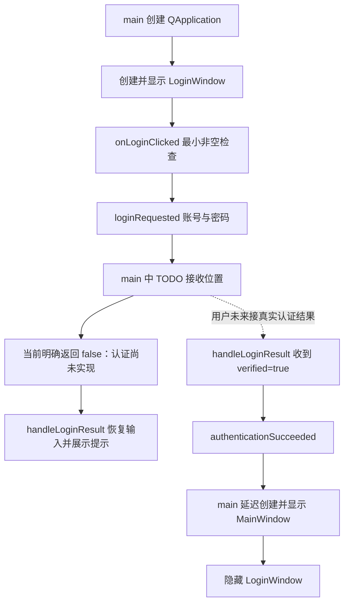

# 16：Qt6 登录窗口 → 验证成功 → 主界面骨架

日期：2026-10-23。阶段：Qt 客户端窗口组织；认证业务由用户实现。

> 2026-10-27 后续界面、接口和文件选择展示已升级，当前入口与练习以 [17：云盘界面升级与补写练习](17-云盘界面升级与补写练习.md) 为准。本文保留首次搭建时的基线与验证记录。

## 1. 本次代码基线与范围

直接修改本地实时仓库 `E:\QtProjects\AsynLogSystem-CloudStorage\Client`，检查时分支为 `main`，HEAD 为 `f05d315`。未使用 ZIP 覆盖本地源码，未拉取、提交或推送 Git 修改。

本地已有 Qt6 Widgets/Network 的 CMake 配置、MainWindow 及 ApiClient 的根路径连接测试。**当前这份源码未找到 D02 文件选择实现**：没有 QFileDialog、已选路径/大小状态或相关 UI；D02 只出现在学习计划中。因此保持原 mainwindow.ui 不变，没有代写文件选择、文件预检或上传逻辑，也不能把 D02 标记为完成。

如果另一个工作副本已实现 D02，应合入该副本对 MainWindow 的修改；这次入口切换不要求删除或重写 D02。没有根据旧聊天图片推测代码。

## 2. 文件与职责

| 文件 | 本次变动 |
| --- | --- |
| [loginwindow.h](../../Client/loginwindow.h) | 新增 LoginWindow、请求意图信号、认证结果槽、成功信号和等待状态 |
| [loginwindow.cpp](../../Client/loginwindow.cpp) | 代码构建账号/密码/登录按钮/状态提示；最小非空预检和状态展示 |
| [main.cpp](../../Client/main.cpp) | 启动只显示登录窗口；认证 TODO 占位；成功后延迟创建主窗口 |
| [CMakeLists.txt](../../Client/CMakeLists.txt) | 加入新 h/cpp，沿用 Qt6 与 AUTOMOC |
| [mainwindow.h](../../Client/mainwindow.h)、[mainwindow.cpp](../../Client/mainwindow.cpp) | 补充对象所有权和信号槽中文注释，连接测试行为不变 |
| [ApiClient.cpp](../../Client/ApiClient.cpp) | 补齐 std::make_shared 直接依赖的 `<memory>` |

没有新增认证服务、认证地址、默认账号、令牌管理、工作线程或上传下载实现。

## 3. 实际调用链



三个接口的边界：

- `loginRequested(account, password)`：只表达提交意图。账号去掉首尾空白，密码原样传递；非空不表示身份有效。
- `handleLoginResult(verified, message)`：只消费正在等待的请求结果。失败恢复输入；成功发出成功信号。不等待请求时收到的结果会忽略。
- `authenticationSucceeded()`：只通知入口切换窗口；不承担会话凭据保存或服务端权限检查。

当前 `main()` 的占位接收方立即回传 `false` 和“登录验证尚未实现”，不会把用户输入当成有效凭据，也不会发送任何认证网络请求。现有 `ApiClient::connectionFinished` 没有连接到认证结果槽；HTTP 200 与登录身份无关。

## 4. 生命周期与信号槽

- 所有窗口、控件和本次回调均在 GUI 线程；没有新建线程或锁。
- QApplication 先创建、最后析构。LoginWindow 是 `main()` 的栈对象，覆盖整个事件循环；其输入框、按钮、标签和布局随 Qt 父子对象树自动销毁。
- MainWindow 由 `std::unique_ptr` 独占，认证成功前连对象都不创建；不设置 `WA_DeleteOnClose`，避免关闭自删与智能指针重复释放。
- 成功回调先 `mainWindow->show()`，再 `login.hide()`，切换时保留可见窗口。栈上的登录窗口不调用 `deleteLater()`。
- 登录窗口是 QDialog，但不使用 `exec()` 启动第二层模态事件循环；入口只使用 QApplication 的事件循环，也不把 QDialog 的 accept/reject 当成认证结果。
- 未登录时关闭登录窗口或按 Esc，会退出程序；成功切换后关闭主窗口，也会退出程序。事件循环返回后依次释放主窗口、登录窗口、QApplication。
- `connect()` 指明接收对象/context，接收对象销毁时 Qt 自动断连。等待状态先设置再发请求信号，以支持同一线程立即返回的结果，避免重入覆盖状态。
- 输入框采用密码显示模式，提交时清空密码框；不记录密码。清空输入框不等于安全擦除 QString 内存。

## 5. 编译与启动

推荐在 Qt Creator 打开 [Client/CMakeLists.txt](../../Client/CMakeLists.txt)，选择 Qt6 的 MinGW 64 位套件，重新配置并构建 `Client`。不要复用此前 Linux 的 `unknown-Debug` 缓存。

本机验证使用 Qt 6.8.3 + Qt 自带 MinGW 13.1 + Ninja；从仓库根目录运行以下 PowerShell 命令：

```powershell
$env:PATH = 'E:\Qt\Tools\mingw1310_64\bin;E:\Qt\6.8.3\mingw_64\bin;E:\Qt\Tools\Ninja;' + $env:PATH

& 'E:\Qt\Tools\CMake_64\bin\cmake.exe' `
  -S Client -B build/client-login-skeleton -G Ninja `
  '-DCMAKE_BUILD_TYPE=Debug' `
  '-DCMAKE_PREFIX_PATH=E:/Qt/6.8.3/mingw_64' `
  '-DCMAKE_CXX_COMPILER=E:/Qt/Tools/mingw1310_64/bin/g++.exe' `
  '-DCMAKE_MAKE_PROGRAM=E:/Qt/Tools/Ninja/ninja.exe'

& 'E:\Qt\Tools\CMake_64\bin\cmake.exe' --build build/client-login-skeleton --parallel 4

& .\build\client-login-skeleton\Client.exe
```

使用命令行启动时须保留上述 PATH，以便找到 Qt 和 MinGW 运行库。配置中 Vulkan 头文件未找到的可选提示未阻止此 Widgets 工程生成、编译和链接。

## 6. 手动演练清单

目前可直接演练：

1. 启动 Client.exe：只出现登录窗口，不出现主页面。
2. 空账号或空密码提交：显示输入提示，不发送认证请求意图。
3. 输入任意非空账号密码，点击登录或按回车：显示“登录验证尚未实现”，停留在登录窗口；密码框清空，可以重试。
4. 关闭登录窗口或按 Esc：进程退出，不在后台留下隐藏主窗口。

完成真实认证后再演练：

1. 认证失败：显示明确失败原因，停留登录窗口，可以重试。
2. 等待认证时：按钮与输入框禁用，重复点击不重复发请求。
3. 真实成功结果返回：只出现一个 MainWindow，登录窗口隐藏；重复成功通知不创建第二个主窗口。
4. 在主页面验证原连接测试：有效地址返回可达；无效格式被本地拦截；停止服务后提示失败并恢复按钮。
5. 关闭主窗口：进程退出；以后补上认证网络请求后，也需验证等待期间关闭窗口能安全取消和释放请求。
6. D02 实现/合入后，继续原文件选择验收：取消不改变有效选择、不发上传请求；显示文件名和大小；空文件和大于 1 MiB 文件不能上传。

不要通过把生产代码的 `false` 改成 `true`、连接成功即登录或添加“跳过登录”按钮来完成正常路径验收。

## 7. 本次实际验证记录

| 检查 | 结果与范围 |
| --- | --- |
| 独立目录配置及 Client.exe 编译链接 | 已通过：本机 Qt 6.8.3 / MinGW 13.1 / Ninja |
| 启动门禁、空输入、未实现提示、回车重试 | 已通过：offscreen 平台运行实际入口代码 |
| 登录窗口关闭和 Esc 退出 | 两种场景均正常结束事件循环并析构窗口 |
| 等待/失败/成功切换、重复成功、主窗口关闭 | 已通过：独立测试程序暂时替换 TODO 接收方，注入结果，只验证界面控制流与所有权 |
| 原连接测试 | 已通过：本地临时 HTTP 夹具返回 200、关闭夹具后失败返回，以及非法 URL 拦截 |
| 原 UI 文件 | 未修改 mainwindow.ui |
| 真实服务端账号认证、真实用户文件操作、D02 文件选择 | 未实现/未验证，不记为通过 |
| 桌面视觉与用户实际点击 | 未做人工视觉验收，仍按上节手动演练 |

测试助手和日志位于本次独立构建目录 `build/client-login-skeleton/`，不加入 Client 的 CMake 目标，不作为生产功能，也没有修改生产占位逻辑。测试成功注入不代表真实认证通过。初次连接失败检查的 2 秒等待不足，改为覆盖原 ApiClient 的 5 秒超时窗口后重测通过；未更改原超时行为。

Qt Creator 在本次操作期间自动刷新了旧 `Client/build/Desktop_x86_windows_msys_pe_64bit_Debug` 下的缓存/索引；这些构建产物不是本次源码补丁，未回滚它们。

## 8. 留给用户的 TODO

- [ ] 定义真实认证契约：地址、方法、字段、响应结构和错误语义；当前旧服务没有提供可供此骨架使用的认证实现。
- [ ] 新增或扩展认证模块，替换 `main.cpp` 的 TODO 接收方；把真实结果通过带 context 的信号槽送回 `handleLoginResult()`，不要保留占位失败接线与真实接线同时工作。
- [ ] 在认证模块实现异步请求、响应解析、超时、取消和重复/过期结果过滤；需要重试并发时引入请求标识，不能仅靠界面的 bool 等待标记区分旧回调。
- [ ] 只有服务端确认身份成功才回传 `verified=true`；网络可达、HTTP 状态成功或 JSON 可解析本身都不足以代表登录成功。
- [ ] 根据契约决定会话/令牌的所有权、有效期与后续请求携带方式；当前成功信号不传递会话，不代表服务端已经做权限隔离。
- [ ] 接真实请求后补上窗口关闭期间的请求取消和资源释放；若使用工作线程，不直接操作界面控件。
- [ ] 在 MainWindow 独立实现或合入 D02 文件选择与本地预检，再沿原学习计划接 D03/D04 上传；本次不代写这些核心业务。

建议断点：`LoginWindow::onLoginClicked` → main 中 TODO lambda → `LoginWindow::handleLoginResult`。当前观察 `loginPending_` 从 false 到 true 再回 false；`verified` 为 false，主窗口智能指针保持空。接入真实认证后，再观察成功信号如何触发延迟创建与显示/隐藏顺序。
