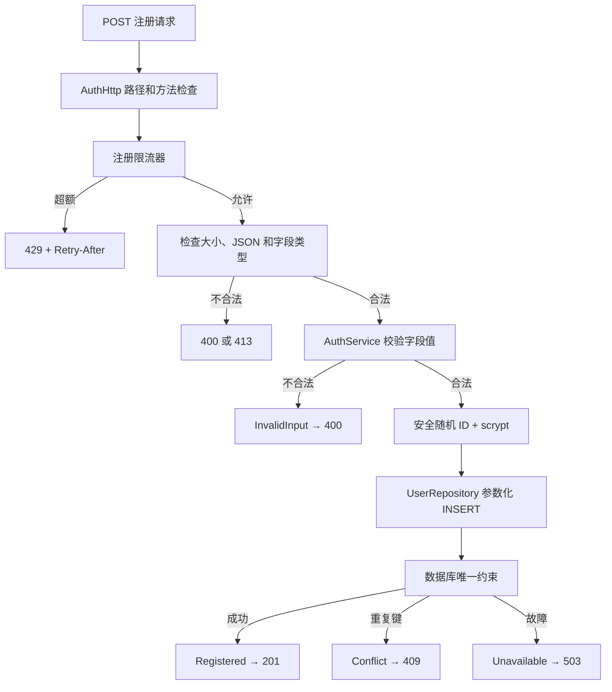

# 服务端注册 A–E：实现步骤、代码理解与验收

日期：2026-11-12。对应 [21：本周登录注册实现路线](21-本周登录注册实现路线.md) 中的服务端注册任务。

这份文档解释本仓库当前采用的实现，不要求你一次背下所有 API。先理解请求如何穿过各层，再理解失败路径，最后运行验收。本文中的“预期结果”不是已完成真实数据库验收的声明。

## 1. 先回答：必须启动数据库吗？

| 工作 | 需要启动 MySQL 吗？ | 原因 |
|---|---|---|
| 编辑 C++、SQL 模板、Python、README | 不需要 | 只是修改文件 |
| 编译代码 | 不需要 | 需要开发头文件和链接库，但不需要数据库进程 |
| 运行限流测试 | 不需要 | 只操作计数器和时间 |
| 运行迁移工具的离线测试 | 不需要 | 使用临时模拟配置，不执行 SQL |
| 预览升级 SQL | 不需要 | 需要已有账号配置文件，但不建立连接 |
| 执行 `--apply` 补授权 | 需要 | GRANT 要交给正在运行的 MySQL 执行 |
| 验证注册入库、并发冲突、会话数量 | 需要 | 必须检查真实数据库状态 |

数据库现在可以保持关闭。先完成代码学习和离线检查，实际部署时再启动。没有 `build/local-auth/*.json` 时，升级工具也无法知道现有随机账号名；它不会猜账号或自动初始化。

## 2. 最终要实现的行为

客户端调用 `POST /api/v1/auth/register`，提供用户名、密码和可选邮箱。服务端独立校验，生成用户 ID，对密码执行 scrypt，再通过用户仓库插入一条记录。

成功响应为 HTTP 201，仅包含公开用户信息。注册成功后客户端回到登录流程；注册本身不创建会话，不返回 token。

```json
{
  "user": {
    "id": "u_0123456789abcdef0123456789abcdef",
    "username": "demo_user"
  }
}
```

上面的 ID 是结构示例，不是真实插入结果。

| 步骤 | 要完成的事 | 核心知识 |
|---|---|---|
| A | 校验用户名、密码、邮箱 | 输入边界、字节长度、匿名命名空间 |
| B | 定义注册结果并实现注册服务 | 业务编排、枚举、哈希、错误传播 |
| C | 增加注册 HTTP 路由 | JSON 类型、状态码、控制流 |
| D | 有界频率限制 | 时间窗口、静态生命周期、固定内存 |
| E | 日志与部署授权 | RAII、最小权限、初始化与迁移区别 |

## 3. 先认清文件和调用关系

| 文件 | 主要职责 |
|---|---|
| [AuthHttp.hpp](../../src/server/auth/AuthHttp.hpp) | 路由、方法检查、限流、JSON 检查、响应与认证日志接线 |
| [AuthService.hpp](../../src/server/auth/AuthService.hpp) | 声明业务接口和结果类型 |
| [AuthService.cpp](../../src/server/auth/AuthService.cpp) | 业务校验、生成 ID、计算哈希、调用仓库 |
| [Crypto.cpp](../../src/server/auth/Crypto.cpp) | 安全随机数、scrypt、密码验证、token 摘要 |
| [UserRepository.cpp](../../src/server/database/UserRepository.cpp) | 参数化用户 INSERT 和查询 |
| [Statement.hpp](../../src/server/database/Statement.hpp) | MySQL 预处理语句、参数绑定、错误映射 |
| [RateLimiter.hpp](../../src/server/auth/RateLimiter.hpp) | 固定窗口限流 |
| [AuthAudit.hpp](../../src/server/auth/AuthAudit.hpp) | 作用域结束时记录认证结果和耗时 |
| [setup_local.py](../../src/server/database/setup_local.py) | 新环境初始化及初始授权 |
| [upgrade_registration.py](../../src/server/database/upgrade_registration.py) | 已有环境预览/执行增量授权 |



日志对象贯穿一次认证处理，正常返回、提前返回和捕获异常后返回都会触发日志。注册这条链中没有 `sessions_.create()`。

## 4. A：三个校验函数到底检查什么

### 4.1 用户名

```cpp
static const std::regex reg(R"(^[a-zA-Z0-9_-]{4,16}$)");
return std::regex_match(username, reg);
```

- `std::regex` 是正则对象；局部 `static` 让它只初始化一次，不为每次注册重新编译表达式。
- `R"(...)"` 是原始字符串字面量，便于表达正则。
- `[a-zA-Z0-9_-]` 限定为 ASCII 字母、数字、下划线或减号。
- `{4,16}` 限定长度；该规则仅允许 ASCII，因此这里的字符数与字节数一致。
- `regex_match` 要求整个字符串匹配。不要替换成只寻找局部匹配的 `regex_search`。

`abc`、包含空格的用户名和中文用户名不符合本次约定；`demo_user` 符合。数据库列长度为 64 不意味着 HTTP 注册也必须放宽到 64；本次业务规则更严格。

### 4.2 密码

```cpp
return pwd.size() >= 8 && pwd.size() <= 1024;
```

`std::string::size()` 计算字节，不是用户看到的 Unicode 字符数。不要声称这里实现的是“8～1024 个汉字或字符”。密码不做 trim，也不自动转换大小写，因为修改输入会改变用户真正设置的密码。

8 字节下限由注册服务负责。底层 `hashPassword` 的非空和上限检查用于保护密码工具自身，两者职责不同。登录沿用现有账号规则，不要求把已有短密码账号强行套用新的注册规则。

### 4.3 邮箱

服务先判断邮箱是否非空；只有填写了才调用 `checkEmail`。目前实现的是基本结构检查：3～254 字节、可见 ASCII、恰好一个 `@`、前后部分非空、点号不能出现在两端或连续出现、域名含点号。

它不是完整的邮件标准验证，也没有验证邮箱归属或域名能否收信。`front()`、`back()` 使用前必须已确认字符串非空，当前代码通过 `at != 0` 和域名长度检查保证这一点。

### 4.4 匿名命名空间

三个函数与 `validToken` 放在 `namespace storage::auth { namespace { ... } }` 中。匿名命名空间限制它们在当前实现文件内使用；它们不需要成为公共头文件接口。成员函数实现仍须位于外层 `storage::auth` 命名空间中。

## 5. B：注册服务是业务流程的中心

### 5.1 为什么定义 RegisterResult

```cpp
struct RegisterResult {
    AuthCode code = AuthCode::NotImplemented;
    std::string userId, username;
};
```

`enum class` 表达明确的业务状态，避免用一个 `bool` 混淆参数错误、用户名冲突与数据库故障。默认 `NotImplemented` 是默认失败：漏赋值时不能误报成功。

注册结果与 `LoginResult` 分开，注册没有 token 和过期时间。仓库内部 `UserRecord` 含密码哈希，不应整体作为 HTTP 响应序列化。

头文件必须同时包含枚举值、结果结构和 `registerUser` 声明。只在 `.cpp` 写实现，调用者无法知道接口。

### 5.2 注册函数的执行顺序

```cpp
if (!checkUserName(username) || !checkPassword(password) ||
    (!email.empty() && !checkEmail(email))) {
    return {AuthCode::InvalidInput, {}, {}};
}
```

`||` 和 `&&` 短路求值；邮箱为空时不调用邮箱校验。返回值中的两个 `{}` 构造空字符串，失败结果不暴露用户身份字段。

校验通过后：

```cpp
user.id = "u_" + randomHex(16);
user.passwordHash = hashPassword(password);
const auto status = users_.insert(user);
```

`randomHex(16)` 先生成 16 字节安全随机数，再编码为 32 位十六进制字符；加 `u_` 后长度为 34。它不是 16 位字符串，也不是时间戳。

`hashPassword` 用随机盐执行 scrypt。数据库保存编码后的算法参数、盐和派生结果，不保存明文。密码哈希不是加密后可以解密取回的密码；验证时使用同样的参数和盐重新计算并比较。

不要把用于 token 摘要的 `tokenHash` 当作密码哈希函数。高熵随机 token 与人类密码的输入特征不同，本仓库已分别提供对应工具。

### 5.3 为什么不先查用户名是否存在

两个请求可能同时查询到“不存在”，然后同时插入。查询无法替代数据库唯一约束。正式流程直接 INSERT，由唯一约束裁决；查询最多只能作为附加提示，不能作为正确性保证。

当前 `Statement.hpp` 将 MySQL 重复键错误 1062 映射为 `DbCode::Conflict`。服务再映射为 `AuthCode::Conflict`。它统一表示唯一键冲突，不精确区分用户名唯一键与用户 ID 主键；不要在没有额外证据时声称一定是邮箱冲突，当前邮箱也没有唯一约束。

### 5.4 失败与成功必须明确分开

```cpp
if (status.code == db::DbCode::Conflict)
    return {AuthCode::Conflict, {}, {}};
if (!status.ok())
    return {AuthCode::Unavailable, {}, {}};
result.code = AuthCode::Registered;
```

只有仓库明确返回成功才设置 `Registered`。成功赋值写成 `RegistrationFailed` 会使“已插入但返回失败”成为确定性错误；`Conflict` 写成小写 `conflict` 则是不同标识符，会编译失败。

返回所需字符串提前复制到结果对象，可减少插入成功后还要进行的可能抛异常的字符串分配。异常统一映射为 Unavailable，但不能用“捕获异常”掩盖错误的成功分支。

单条 InnoDB INSERT 不会形成只有部分字段落库的半条记录。不过数据库已经提交、网络响应丢失时，客户端仍可能看到失败或超时。这是分布式交互的结果不确定性，不能承诺“任何失败响应都代表数据库绝对没有新行”。重试同一用户名会由唯一约束阻止重复；更完整的重试语义需要另行设计幂等机制。

正常连接使用默认自动提交。若未来在外层显式开启事务，必须由事务所有者在返回最终成功之前处理提交；不要随意在仓库中强行提交调用者的事务。

## 6. C：HTTP 层校验为何不与服务重复

| 层 | 负责的问题 | 示例 |
|---|---|---|
| AuthHttp | 请求能否正确读取 | JSON 是否对象、password 是否字符串、body 是否超限 |
| AuthService | 读取出的值是否合法 | 密码是否至少 8 字节、邮箱结构是否合法 |
| UserRepository / MySQL | 数据能否安全持久化 | 参数绑定、唯一约束、执行错误 |

`{"password":12345678}` 在 HTTP 层拒绝；`{"password":"abc"}` 类型正确，进入服务层后因长度不足拒绝。先 `isString()`，再 `asString()`，不要依赖隐式转换。

### 6.1 路由控制流

`handle` 对未知路径返回 false，表示交给其他路由；对已处理请求返回 true。注册分支发送响应后必须返回 true，避免继续落入登录、me 或 logout 分支，再次查询会话或发送第二份响应。

POST 注册不要求已有 Bearer。现有 `Service::GenHandler` 先调用 `AuthHttp::handle`，再给旧文件路由做登录检查；这个顺序让未注册用户可以访问注册入口。

### 6.2 JSON 与大小边界

- 原始注册请求体大于 4096 字节时返回 413；空请求体返回 400。
- 根节点必须是对象；数组、数字、字符串和 null 都拒绝。
- username/password 必须存在且为字符串。缺少字段时取到的 JSON 空值不满足 `isString()`。
- email 可以缺省或为空字符串；显式 `null` 不等于“没传”，当前返回 400。
- `rejectDupKeys` 拒绝重复键；`failIfExtra` 拒绝合法 JSON 后附加的其他内容；注册解析配置关闭注释和尾随逗号。
- 当前没有要求拒绝所有未知字段，也没有在路由中单独校验 Content-Type；不要把未实现的检查写成验收通过。

4096 是编码后请求体的字节数。JSON 转义可能使原始请求体大于解码后的字段长度，因此同时检查请求体和字段长度是必要的。

`unique_ptr<Json::CharReader>` 自动释放解析器。`evbuffer_pullup` 返回 libevent 管理的缓冲区地址，这里只是借用，不应手工 delete/free。

### 6.3 状态码约定

| 条件 | HTTP 状态 |
|---|---:|
| 插入成功 | 201 |
| JSON / 字段类型 / 字段值错误 | 400 |
| HTTP 方法错误 | 405，附 Allow |
| 唯一键冲突 | 409 |
| 注册请求体过大 | 413 |
| 限流 | 429，附 Retry-After |
| 数据库或内部故障 | 503 |

当前登录已有逻辑对超大登录体返回 400，注册返回 413；不要把两者混写。超过服务总接收上限的请求可能在 libevent 层被拒绝，未必经过认证日志。

## 7. D：有界限流逐行理解

### 7.1 保存哪些状态

`limit_` 是额度，`used_` 是本窗口已用次数，`windowEnd_` 是窗口结束点。两个接口各一个实例，不按账号或 IP 保存 map，因此内存不随任意输入增长。

当前配额：注册每窗口 5 次，登录 10 次，窗口均为 60 秒。额度属于整个进程，其他用户可能被同一批请求影响。这是当前实现的公平性边界，不是按用户隔离的限流。

### 7.2 为什么使用 static 和 steady_clock

`handle` 内局部 static 对象在多次请求之间保留。如果改成普通局部变量，每次进入函数都重新初始化，就永远无法累计到限额。

`steady_clock` 测量时间间隔，不受系统墙上时钟跳变影响。用 `now >= windowEnd_` 判断窗口结束，重置计数并从当前请求开始新窗口。

static 初始化本身的线程安全，不等于之后对 `used_` 的修改线程安全。当前仓库和 HTTP 运行在同一个 libevent 线程；未来多线程必须一起重新设计共享状态和数据库连接使用方式。

### 7.3 检查函数的三个分支

1. 窗口已结束：计数清零，结束时间更新为 now + 60 秒。
2. 还有额度：计数加一，返回 0，允许请求继续。
3. 没有额度：返回剩余时间向上取整后的秒数，不修改窗口结束时间。

剩余 0.9 秒必须返回 1，而不是截断为 0，否则调用者会误认为允许。反复收到拒绝也不能不断延长封禁时间。

`check` 的可选 now 参数只用于测试时间边界。生产调用仍为 `check()`，从服务器时钟取值，不从 HTTP 输入取时间。

### 7.4 为什么放在密码哈希之前

scrypt 是昂贵操作，限流的目标之一就是减少进入密码派生和数据库操作的次数。因此先限流，再解析 JSON 和执行注册。错误 JSON、错误密码也扣额度；HTTP 方法错误在前面拒绝，不扣这里的额度。

429 返回 Retry-After 秒数。等待后仍可能因其他用户已经消耗新额度而再次收到 429；该响应头是重试建议，不是未来额度预留。

### 7.5 固定窗口的边界

窗口结束前用完 5 次，窗口结束后立即又可使用 5 次；所以不能说“任意连续 60 秒严格不超过 5 次”。这是固定窗口，不是滑动窗口。

进程重启会重置额度，多进程分别计数。已有 scrypt 和 SQL 同步执行仍会阻塞事件循环；限流减少进入次数，但不会把工作变成异步。后续可考虑带容量上限和过期回收的按 IP 记录、全局额度、独立认证工作队列；这些不属于本次已实现功能。

## 8. E-1：日志为什么适合用 RAII

`AuthAudit audit(operation);` 在一次认证处理开始时创建，保存固定操作名和开始时间。局部对象离开作用域时析构，无论途中哪一个分支 return，都能记录一次认证日志。

两个局部 lambda 捕获 `&audit`：先 `setStatus(status)`，再调用 `AuthHttp::reply` 或 `AuthHttp::failure`。这里限定类名调用原静态函数，避免调用包装器自身形成递归。audit 生命周期覆盖这些 lambda 的使用。

析构函数标记 noexcept，内部捕获日志器异常；失败时退回到 stderr。不能因为日志器出错而把已成功的注册变成失败，也不能在错误处理里递归调用同一个已失败的日志器。

```text
auth operation=register status=201 cost_us=245000
auth operation=register status=409 cost_us=231000
auth operation=login status=429 cost_us=18
```

这三行仅为格式示例。记录的是尝试发送的 HTTP 结果和处理函数耗时，并不证明客户端已收到响应。现有外层 ScopeTimer 仍可能记录自己的回调耗时；“一条认证日志”不等于整个请求只有一条日志。

操作名只用 register/login/logout/me；不拼接外部输入。禁止记录完整请求体、密码、密码哈希、完整 token、Authorization、数据库密码。错误定位优先记录固定操作和状态、必要时经过筛选的数字错误码。

## 9. E-2 / E-3：初始化与增量升级

### 9.1 两类账号不可混淆

- `users` 表里保存的是云盘用户，例如 demo_user。
- `storage_app_...` 是 MySQL 账号，供服务连接数据库。

GRANT 授权的是后者，不是给每个新注册用户创建 MySQL 账号。整个注册接口通过业务数据库账号的 INSERT 权限写 users 表。

### 9.2 最小权限表

| 数据库身份 | users | sessions | 范围 |
|---|---|---|---|
| 业务账号 | SELECT、INSERT | SELECT、INSERT、DELETE | asynlog_storage |
| HTTP 测试账号 | SELECT、INSERT | SELECT、INSERT、DELETE | asynlog_storage_test |
| 测试数据账号 | 原有测试 DML 权限 | 原有测试 DML 权限 | 仅测试库 |
| 管理员 | 执行初始化和授权 | 执行初始化和授权 | 不作为 HTTP 运行账号 |

注册只新增 users INSERT，不要求 users UPDATE/DELETE、DDL 或 GRANT OPTION。表上的 DELETE 会影响所有可匹配行，并不是“只允许删除当前登录用户”，所以不能随意添加。

### 9.3 新环境

`setup_local.py` 创建数据库和随机账号时，就授予 SELECT,INSERT。它拒绝覆盖已有 runtime.json，所以不能把重新初始化当作升级方法。001 SQL 文件底部的授权示例是注释；修改注释不会自动执行 GRANT。

### 9.4 已有环境：预览再执行

在 Linux 部署机器的仓库根目录：

```bash
# 不需要 MySQL 启动，但需要已有 local-auth 配置。
python3 src/server/database/upgrade_registration.py

# 确认数据库启动、预览目标正确后执行。
python3 src/server/database/upgrade_registration.py --apply --admin root
```

默认处理 runtime 与 http-test 两套账号。只升级业务环境：

```bash
python3 src/server/database/upgrade_registration.py --target runtime
python3 src/server/database/upgrade_registration.py --target runtime --apply --admin root
```

不在默认配置目录时加 `--config-dir /实际路径/local-auth`。不是 root 的授权管理员可替换 `--admin`；这只影响一次性迁移连接，绝不能把 runtime 配置里的业务账号换成 root。

### 9.5 工具内部需要理解什么

1. argparse 区分默认预览与显式 --apply，默认无数据库副作用。
2. 读取固定配置文件，仅提取目标库名、账号、主机和端口用于计划；不输出业务密码。
3. 严格校验固定库名、127.0.0.1 和初始化脚本产生的账号格式，再替换模板。标识符不能像普通 SQL 值一样直接绑定，因此这里使用严格白名单，不能照搬成接受任意输入的字符串拼接。
4. 先验证全部所选配置，再连接。第二份配置缺失时，第一份也不会先执行。
5. --apply 在终端隐藏输入管理员密码，写入临时私有目录内的 0600 MySQL 选项文件；进程命令行只有文件路径，不含密码，作用域结束删除文件。
6. 调用 MySQL 客户端执行 GRANT INSERT，并用 SHOW GRANTS 显示核查结果。工具不启动数据库、不创建账号、不改原配置、不创建或删除表。

工具仅支持本仓库初始化脚本生成的本机配置。自定义库、账号或远程部署应人工核对模板，不应为了让脚本通过而修改真实账号配置。当前工具不撤销既有多余权限；SHOW GRANTS 若显示过宽授权，应单独评估收紧。

多条 GRANT 不构成一个可回滚事务。中途失败可能已有一条生效；解决原因后重复授予同一项权限可以继续完成升级。不要在失败时自动删除用户或回滚到不相关权限集合。

## 10. 分阶段验收：不要把离线通过当成上线通过

### 10.1 离线检查（当前可以执行）

Linux 仓库根目录：

```bash
python3 src/server/tests/registration_migration_test.py
mkdir -p build/registration-checks
g++ -std=c++17 -Wall -Wextra -pedantic src/server/tests/rate_limiter_test.cpp -o build/registration-checks/rate_limiter_test
./build/registration-checks/rate_limiter_test
```

Windows 可用 python 代替 python3，输出程序加 .exe，目录用 PowerShell 创建。测试不需要 MySQL。

迁移测试使用临时的虚构配置，覆盖：正确目标生成、默认预览零连接、不输出模拟密码、异常标识符/库名/端口拒绝、缺少第二份配置时不执行第一份、不同端口分开升级。

限流测试注入时间，覆盖注册第六次拒绝、登录第十一次拒绝、剩余不足一秒向上取整、窗口恰好结束恢复、拒绝不延长窗口、两种额度独立、长时间空闲恢复和零额度拒绝。

### 10.2 实际授权（需要 MySQL）

先预览，再在部署主机执行 --apply。检查 SHOW GRANTS，并重连服务。没有运行该命令时，不能因为模板存在就宣布数据库已升级。

### 10.3 HTTP 与数据库验收（需要完整服务可编译）

使用隔离测试库与测试 HTTP 账号，避免把测试用户写入日常业务库。每组测试使用新进程或等待窗口恢复；不要让前一组消耗的额度污染后一组结果。

| 用例 | 预期 HTTP | 数据库/额外检查 |
|---|---:|---|
| 合法新用户名 | 201 | 对应用户名恰好一条记录；该 user_id 会话数为 0 |
| 同用户名再次注册 | 409 | 用户条数仍为 1 |
| 两个并发请求注册同一合法用户名 | 一个 201、一个 409 | 在剩余额度充足时执行，用户条数为 1 |
| 缺密码、密码为数字、邮箱 null | 400 | 不新增用户 |
| 根节点数组、损坏 JSON、重复键 | 400 | 服务继续响应后续请求 |
| 用户名 3/17 位、密码 7/1025 字节 | 400 | 不新增用户 |
| 合法边界用户名 4/16 位、密码 8/1024 字节 | 201 | 每个用例用不同账号；受请求体上限约束 |
| 注册体 4097 字节 | 413 | 不做密码哈希或 INSERT |
| GET 注册 | 405 | Allow 为 POST |
| 缺少 INSERT 权限 | 503 | 用独立测试账号演练，不改业务权限 |
| 不可达测试数据库 | 503 或启动连接失败 | 若启动即失败，不能将其记为已验证 HTTP 503 |
| 6 次 POST 空对象注册 | 前 5 次 400，第 6 次 429 | 需全新窗口，无用户入库 |
| 等待 Retry-After 后重试空对象 | 400 | 证明额度恢复，而非注册成功 |

注册测试用户名建议使用 `reg_` 加 8 位十六进制后缀，总长 12，符合 4～16 限制。已有登录测试的 `http_test_` 加长后缀是仓库直接植入的数据，不应原样拿来当注册接口输入。

查询只选需要的公开字段，不用 SELECT * 将密码哈希打印出来：

```sql
SELECT id, username FROM users WHERE username = '本次测试用户名';
SELECT COUNT(*) FROM users WHERE username = '本次测试用户名';
SELECT COUNT(*) FROM sessions
WHERE user_id = (SELECT id FROM users WHERE username = '本次测试用户名');
```

上面是手工核查模板。自动化测试仍应使用参数绑定。清理时用测试数据账号和精确测试用户条件，不删除整张表、不停业务数据库。

### 10.4 日志验收

使用一次性测试密码、测试 token 和隔离数据库凭据，检查控制台日志与日志文件中均不包含它们。检查成功、参数错误、冲突、限流、服务故障都有固定操作名、HTTP 状态和耗时。不要为了检查日志，先把真实凭据打印到终端或聊天。

现有 `auth_http_test.py` 主要覆盖登录、会话持久化和注销，不应被描述成已经覆盖本表所有注册用例。本次新增的是离线迁移和限流检查，真实注册全链路仍需按表执行或补充专用集成测试。

## 11. 本次核查发现的阻塞与改动边界

本轮补全了注册头文件声明和结果类型，纠正 Conflict / Registered 枚举，补全命名空间收尾，整理限流实现并支持可控时间测试，增加增量授权模板、升级工具、离线测试和本学习文档。保留用户正在修改的会话仓库，未用旧版本覆盖它。

当前完整服务仍有独立的会话仓库阻塞：

- SessionRepository.hpp 的 SessionRecord 定义结尾缺少分号。
- insert 声明中的 Dbstatus 应与类型 DbStatus 大小写一致。
- SessionRecord 中的 id_ / exiresAtUtc 与 cpp 使用的 userId / expiresAtUtc 字段名不一致，也需要统一。
- 构造函数同时在头文件内定义和 cpp 中定义，修复前两项后仍需处理重复定义。
- 当前 cpp 主要提供 insert，而既有 AuthService 仍调用 create/find/revoke；需统一接口并恢复相应实现。
- 新会话 INSERT 使用 token_digest，而迁移表列名为 token_hash，需统一，否则运行时报 SQL 列错误。
- Windows 直接编译现有 Linux 服务代码时，gmtime_r 也不可用；部署构建应在 Linux 进行，跨平台适配是另一项工作。

2026-11-12 当前环境：Windows 工作区没有 build/local-auth 配置；尝试启动 Ubuntu WSL 时其 ext4.vhdx 路径缺失。用户说明数据库尚未启动。因此本轮没有执行真实 GRANT，也没有声称完整服务构建或注册入库验收通过。这些限制不影响离线测试和阅读本文。

本轮实际验证记录：

| 检查 | 结果 | 能证明什么 |
|---|---|---|
| registration_migration_test.py | 5 项测试通过 | 目标预检、预览无连接、异常输入拒绝和不输出模拟密码 |
| rate_limiter_test.cpp | C++17 编译通过，21 次断言通过 | 限流计数、时间边界、恢复与额度独立 |
| 新增 Python 文件语法检查 | 通过 | 升级工具与离线测试可以被 Python 解析 |
| AuthService.cpp 本机语法检查 | 未通过 | 暴露上述会话头文件错误和 Windows 的 gmtime_r 差异，不能宣称全服务可构建 |
| 实际 GRANT / 注册入库 / 并发冲突 / 故障恢复 | 未执行 | 需要已启动的数据库、已有配置和可运行服务 |

## 12. 学完后应能自己回答的问题

1. HTTP 类型校验和服务层业务校验为什么都要存在？
2. 可选邮箱为什么允许缺省，但拒绝显式 null？
3. string.size() 的单位是什么？它与 JSON 请求体大小有什么区别？
4. 用户 ID 的 16 字节随机数为什么对应 32 位 hex？最终长度为何是 34？
5. 为什么不能用普通 SHA-256 直接代替当前密码哈希函数？
6. “先查询再插入”为什么不能解决并发重名？
7. 数据库失败、用户名冲突、输入不合法为什么不能都返回 false？
8. 注册成功为什么不调用 sessions_.create？
9. 注册分支处理完为什么必须 return true？
10. static 初始化安全为什么不等于整个限流器线程安全？
11. 为什么剩余不足一秒必须向上取整？为什么拒绝请求不能延长窗口？
12. 固定窗口能否保证任意连续 60 秒内不超过额度？
13. RAII 如何让多个提前 return 都有日志？析构函数为什么不能传播异常？
14. 修改 setup_local.py 为什么不会改变已有账号权限？
15. 云盘用户和 MySQL 业务账号的区别是什么？
16. 离线测试通过、完整服务编译通过、真实注册验收通过分别证明了什么？

建议练习：先不看答案画出完整请求链，再口述非法 JSON、重复用户名、数据库断连、额度耗尽四条失败路径；最后对照代码确认每一条在哪里返回、返回什么状态、是否写数据库、是否留下日志。
