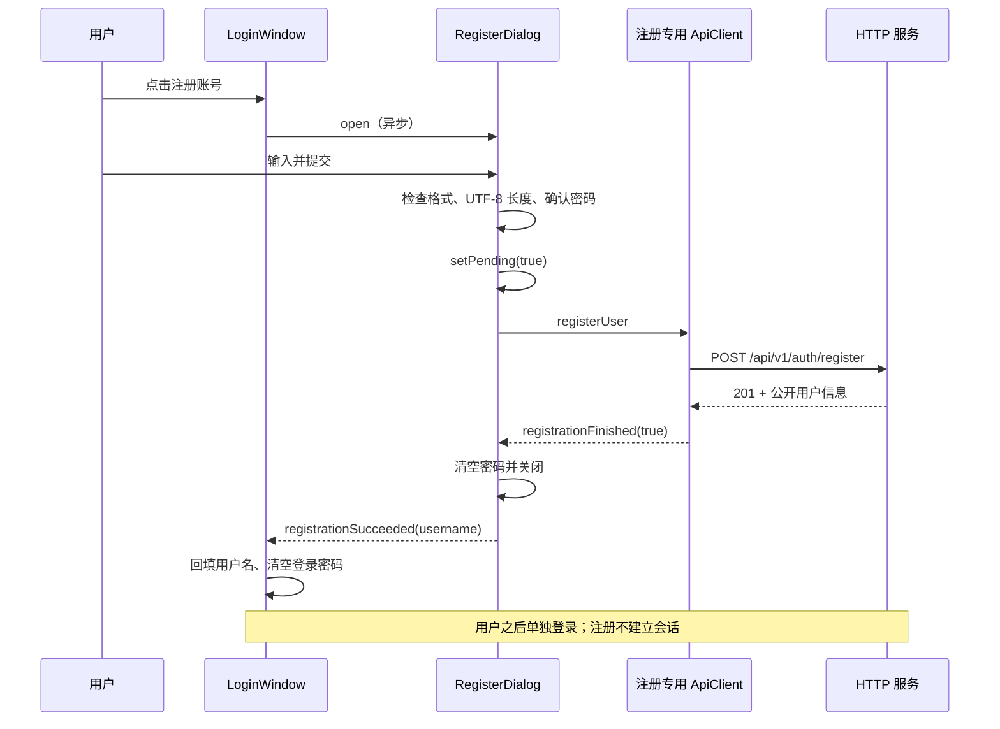

# 周五：Qt 注册、登录交互与验收

日期：2026-11-12。衔接 [22：服务端注册 A–E](22-服务端注册A-E实战与代码讲解.md)。

本次完成客户端交互和本机模拟 HTTP 验证。模拟服务测试不连接 MySQL，不能代替实际服务端注册入库验收；数据库和服务端准备好后，按本文最后一节联调。

## 1. 从用户视角走一遍

1. 登录页填写服务器根地址，点击“注册账号”。
2. 注册对话框显示本次使用的服务器地址，并提供用户名、密码、确认密码和返回登录。
3. 输入时即提示用户名规则、密码长度和两次密码是否一致。密码不一致时点注册不会发请求。
4. 提交后输入框与注册按钮禁用，“返回登录”和系统关闭仍可操作。
5. 成功后关闭注册对话框，登录页回填用户名，清空原登录密码，不自动进入主窗口。
6. 输入密码登录；只有服务器返回完整合法的登录结果，才发出 authenticationSucceeded 并切换到主窗口。
7. 注册失败保留当前用户名和密码供修正或重试；关闭注册框会清除密码输入。登录沿用之前提交后清空密码的行为。

## 2. 七条要求与实现位置

| 要求 | 实现 |
|---|---|
| 注册入口和三个字段 | LoginWindow::onRegisterClicked，RegisterDialog 构造函数 |
| 即时校验、确认密码、本地预检 | RegisterDialog::validationError / updateHint / submit |
| 异步网络统一入口 | ApiClient::registerUser / login |
| 防重复、失败恢复、销毁安全 | pending_、authenticationReply_、setPending、带 context 的 connect、cancelAuthentication |
| 区分失败类型 | ApiClient.cpp 中 authenticationFailure |
| 注册返回登录、仅认证后进主窗 | registrationSucceeded 只回填；main.cpp 监听 authenticationSucceeded |
| 明确超时、等待可操作 | 默认 10000 ms 的单次 QTimer；异步 open/post，不用窗口 exec 等待网络 |

## 3. 文件阅读顺序

1. [registerdialog.h](../../Client/registerdialog.h)：字段、等待状态和对外成功信号。
2. [registerdialog.cpp](../../Client/registerdialog.cpp)：界面、校验、提交、结果处理与退出清理。
3. [ApiClient.hpp](../../Client/ApiClient.hpp) / [ApiClient.cpp](../../Client/ApiClient.cpp)：请求、超时、取消和协议校验。
4. [loginwindow.cpp](../../Client/loginwindow.cpp)：注册入口、用户名回填和登录等待状态。
5. [main.cpp](../../Client/main.cpp)：主窗口只在认证成功后构造。
6. [registration_test.cpp](../../Client/tests/registration_test.cpp)：用模拟 HTTP 返回值驱动真实 Qt 网络和控件。

## 4. 关键流程



注册对话框有自己的 ApiClient。这样关闭旧对话框再打开新对话框时，旧请求不会被新页面当成本次注册结果；登录页的 ApiClient 继续负责登录和登录后的会话。

## 5. 本地校验不替代服务器校验

用户名使用 `\A[a-zA-Z0-9_-]{4,16}\z` 匹配整段输入。这里不自动 trim 用户名，避免界面内容与实际注册名称不一致。密码与确认密码都不去空格。

密码长度采用 `text().toUtf8().size()`，与服务端接收到的 UTF-8 字节数对应。QString::size() 不是 UTF-8 字节数，不能直接照搬服务端 std::string::size() 的规则。

确认密码只用于本地检查，不发送给服务器。最终注册 JSON 只有 username/password；此次 UI 不收集可选邮箱。

客户端校验主要减少误操作、缩短反馈时间。HTTP 工具可以绕过 Qt，因此服务端依然必须检查 JSON 类型、大小、用户名与密码规则。

## 6. 异步状态与防重复

两个层面同时防重复：

- UI 层：pending_ 为 true 时 submit 直接返回，同时禁用提交按钮和字段。
- ApiClient 层：authenticationReply_ 非空时拒绝启动另一个认证请求，避免其他调用入口绕过按钮状态。

开始请求前先进入等待状态，再调用 ApiClient。地址错误等失败可能同步发信号；若反过来先请求再设置 pending，界面可能漏接失败后永久处于等待。

finished 到达时先清除 ApiClient 的在途指针，再通知窗口。窗口先恢复控件，然后展示失败或关闭成功页面。这样结果槽里立即重试也不会被上一请求状态阻挡。

默认总等待时间为 10 秒；定时器触发时先设置 requestTimedOut 标记，再 abort。必须保留该标记，否则 abort 的错误可能被当成普通取消而不是超时。

超时仅结束本地等待，不能保证服务器没完成 INSERT。因此注册超时/网络失败提示“结果尚未确认”；重试后若收到 409，可返回登录尝试原账号。不要把取消等待当作撤销注册。

## 7. 生命周期：为什么不会访问已销毁窗口

- 对话框使用 new 创建、父对象为 LoginWindow，并设置 WA_DeleteOnClose。不能把这种自动删除设置用于 main 中的栈上 LoginWindow。
- 登录页使用 QPointer 跟踪注册对话框，目标销毁时指针自动归空。
- connect 使用接收对象/context。窗口或 ApiClient 销毁时，对应连接自动断开。
- ApiClient 拥有 QNetworkAccessManager；reply 的定时器以 reply 为父对象。
- 返回登录、关闭或 Esc 最终走 RegisterDialog::done：取消在途认证，恢复状态，清空密码，再关闭。
- cancelAuthentication 先断开 reply 到 ApiClient 的结果回调，再 abort，因为 abort 也会触发 finished。取消不发成功或失败信号，也不允许迟到结果切页。
- reply 使用 deleteLater，避免在信号处理中直接删除正在发信号的对象。
- 登录窗口 reject 也取消认证；即使栈对象尚未析构，关闭后也不会因迟到登录成功而重新打开主窗口。

注册完成时 accept 可能触发外部 finished 槽，所以代码用 QPointer guard 检查自己是否仍存活，再发 registrationSucceeded。对外发信号后不继续访问成员，也能降低外部槽立即销毁对象的风险。

## 8. 错误分类和登录门禁

| 情况 | 提示含义 |
|---|---|
| 400 / 422 | 输入不符合要求 |
| 413 | 提交内容过长 |
| 409 | 账号已存在，可修改用户名或返回登录 |
| 429 | 请求过多；有效 Retry-After 秒数会显示出来 |
| 5xx | 服务暂不可用 |
| 登录 401 | 账号或密码错误 |
| 总等待时间到期 | 请求超时，可重试 |
| 连接被拒绝、断网等 | 网络连接失败 |
| 201/200 但 JSON 或关键字段错误 | 响应异常，不能确认成功 |

Qt 在收到 HTTP 4xx/5xx 时，也可能设置网络错误。因此先识别已知 HTTP 状态，再判断其他网络错误，才能正确显示 409、429 和 503。

不直接把远端错误正文当 HTML 显示，也不输出密码或 token。状态标签使用 PlainText，错误提示由本地固定文案生成。

注册只接受 HTTP 201、合法 JSON、非空 user.id，以及与提交用户名一致的 user.username。注册不保存 token。

登录保留既有校验：HTTP 200、无网络错误、合法 JSON、64 位小写十六进制 token、有效且未到期的 expiresAt、非空用户身份。测试连接只访问 /health，不会发出 authenticationSucceeded。返回 200 但缺 token 的“成功”响应也不能打开主窗口。

## 9. 构建与离线交互测试

使用 Qt 6 Widgets、Network；测试另外使用 Qt Test。业务客户端不要求启动 MySQL。

本机 Windows PowerShell（仓库根目录）：

```powershell
$env:PATH = 'E:\Qt\6.8.3\mingw_64\bin;E:\Qt\Tools\mingw1310_64\bin;' + $env:PATH
& E:/Qt/Tools/CMake_64/bin/cmake.exe -S Client -B build/client-registration -G Ninja -DCMAKE_MAKE_PROGRAM=E:/Qt/Tools/Ninja/ninja.exe -DCMAKE_CXX_COMPILER=E:/Qt/Tools/mingw1310_64/bin/g++.exe -DCMAKE_PREFIX_PATH=E:/Qt/6.8.3/mingw_64 -DBUILD_TESTING=ON
& E:/Qt/Tools/CMake_64/bin/cmake.exe --build build/client-registration --parallel 4
& E:/Qt/Tools/CMake_64/bin/ctest.exe --test-dir build/client-registration --output-on-failure
& ./build/client-registration/Client.exe
```

这些 Qt 路径来自当前机器；换机器应使用实际安装路径或 Qt Creator 对应 Kit。运行客户端需要 Qt 动态库在 PATH 中，直接双击未部署依赖的 exe 可能找不到 DLL。

测试报告：`build/client-registration/registration-tests.txt`。界面预览：`build/client-registration/registration-preview.png`，均为忽略的构建输出。

本次 Qt 6.8.3 + MinGW 构建通过；测试结果 20 passed、0 failed（包含初始化与清理）。测试通过本机 TCP 模拟 HTTP 响应，实际运行 ApiClient 和窗口控件，覆盖：

- 注册请求路径、JSON 内容、重复调用只发一次请求、不带认证头、不自动保存会话。
- 输入错误、重复账号、限流、服务故障、内容过长、异常 JSON、用户名不匹配和重定向响应。
- 密码不一致即时提示且零请求，非法用户名/短密码零请求。
- 注册超时后控件恢复、GUI 定时事件继续运行、原输入保留并可重试成功。
- 连接失败后恢复网络，可以再次注册。
- 注册成功返回登录、回填账号并清除密码，再登录成功进入主窗口。
- /health 成功、登录缺 token、错误密码均不进入主窗口。
- 登录超时、429、503 后可再次登录。
- 关闭注册框后旧响应不污染新注册框，关闭或销毁登录窗口后旧响应不再认证。

测试中 120 ms 超时仅用于快速演练；实际默认仍为 10000 ms。部分 offscreen 平台日志关于字体目录或尺寸提示属于测试平台能力提示；Windows 截图测试额外加载了本机中文字体，未修改生产环境字体配置。

## 10. 真实服务验收（待数据库与服务就绪）

1. 修复并构建服务端，启动 MySQL；按第 22 份文档补齐业务/HTTP 测试账号 INSERT 权限，启动 HTTP 服务。
2. Qt 登录页填写实际可访问的服务器地址。测试连接成功只能证明可达。
3. 全程使用 Qt 注册一个新的合法用户名，不用数据库工具预先创建该云盘用户。
4. 密码不一致时确认服务端没有收到注册请求；合法输入后连续点击只产生一次请求。
5. 注册成功回登录页，确认用户名已填写、密码为空，再输入密码登录并进入主窗口。
6. 使用同名账号再次注册，看到账号重复提示；测试 429 时注意服务端为共享额度，不是单用户额度。
7. 关闭网络或使用不可达地址，确认错误提示正确且按钮恢复；网络恢复后可以重试。
8. 在延迟响应期间关闭对话框/登录窗口，不应崩溃、误回填或重新打开主窗口。

当前仓库的会话仓库仍有第 22 份文档列出的接口和字段不一致问题，实际完整服务验证受其影响。此轮仅修改客户端及文档，不覆盖用户正在进行的服务端练习。不能将本机模拟 HTTP 的通过结果写成真实 MySQL 已注册并登录成功。

## 11. 建议掌握的知识点

- 信号表示请求意图与信号表示服务器确认结果之间的区别。
- QString、UTF-8 QByteArray 与字节长度之间的关系。
- QObject 父子所有权、QPointer、带 context 的 lambda 连接、deleteLater。
- QDialog::open 与 exec 的差异；异步请求不需要嵌套等待循环。
- UI pending 状态与 ApiClient 请求状态为什么需要同时保护。
- HTTP 状态码与 QNetworkReply::NetworkError 为什么不能混为一谈。
- 超时、取消、服务端完成之间为什么存在结果不确定性。
- 为什么注册成功不等于登录成功，连接测试成功更不等于认证成功。

参考 Qt 官方说明：[QDialog 异步打开与生命周期](https://doc.qt.io/qt-6/qdialog.html)、[QNetworkReply 的 abort 与释放](https://doc.qt.io/qt-6/qnetworkreply.html)、[QObject 连接与对象销毁](https://doc.qt.io/qt-6/qobject.html)。实现已在本机 Qt 6.8.3 编译和测试。
