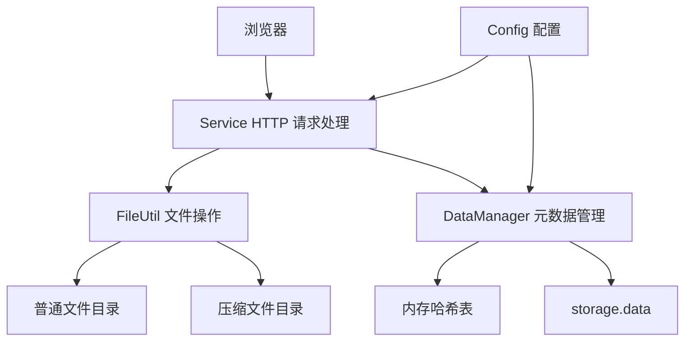

# 存储部分学习笔记

本文结合当前项目源码，沿着“启动服务 → 上传文件 → 管理元数据 → 展示列表 → 下载文件”的顺序讲解。目标是理解每一步由谁负责、数据存在哪里、为什么这样设计，以及当前实现还缺少什么。文中的改进建议尚未实现。

## 1. 先理解：这里的“存储”是什么

项目的存储部分是一个使用本地磁盘保存文件的 HTTP 服务。浏览器负责选择文件、发起请求和展示结果，C++ 服务端负责接收数据、写入磁盘、维护文件信息并响应下载。

当前没有接入对象存储、分布式节点或数据库，也没有账户体系。所谓“深度存储”，是上传时压缩后保存，下载时再解压；普通存储则直接保存原始数据。存储模式由用户选择，代码没有根据访问频率自动迁移文件。

学习时先区分三类数据：

| 数据 | 保存位置 | 作用 |
| --- | --- | --- |
| 文件内容 | `low_storage/` 或 `deep_storage/` | 真正的文件字节，后者保存压缩结果 |
| 内存元数据 | `DataManager::table_` | 根据下载 URL 找到文件路径、大小和时间 |
| 持久化元数据 | `storage.data` | 将文件索引保存为 JSON，供重启加载 |

例如普通上传 `hello.txt` 后，磁盘上会出现 `./low_storage/hello.txt`，内存表会记录 `/download/hello.txt` 对应的文件信息，`storage.data` 保存这条信息的 JSON 表示。

元数据不是文件内容的副本。如果文件丢失，仅凭 `storage.data` 无法恢复文件；如果索引丢失，当前启动逻辑也不会自动扫描目录重建全部索引。

## 2. 各个模块负责什么

| 源码 | 主要职责 | 阅读重点 |
| --- | --- | --- |
| [Test.cpp](Test.cpp) | 初始化日志、元数据和服务线程 | `main`、`service_module` |
| [Config.hpp](Config.hpp) | 读取并提供服务配置 | `ReadConfig`、`GetInstance` |
| [Storage.conf](Storage.conf) | 端口、目录和元数据路径等配置 | 相对路径基于进程工作目录 |
| [Service.hpp](Service.hpp) | HTTP 路由、上传、列表、下载 | `GenHandler`、`Upload`、`ListShow`、`Download` |
| [DataManager.hpp](DataManager.hpp) | 元数据结构、内存索引、持久化 | `StorageInfo`、`Insert`、`Storage`、`InitLoad` |
| [Util.hpp](Util.hpp) | 文件读写、压缩、JSON、URL 解码 | `FileUtil`、`JsonUtil` |
| [index.html](index.html) | 上传交互与文件列表模板 | `uploadFile`、两个模板占位符 |
| [客户端 Storage.hpp](../client/Storage.hpp) | 扫描本地文件，判断是否需要上传 | `RunModule`、`IfNeedUpload` |

模块间的关系可以这样理解：`Service` 决定处理什么请求，`FileUtil` 负责操作文件，`DataManager` 负责记住这些文件，`Config` 提供它们使用的参数。



## 3. 服务如何启动

入口位于 `Test.cpp`，执行顺序如下：

```text
main
  ├─ log_system_module_init()
  ├─ new storage::DataManager()
  │    ├─ Config::GetInstance() → ReadConfig()
  │    ├─ 初始化读写锁
  │    └─ InitLoad() → 恢复元数据
  ├─ 创建线程 t1，执行 service_module()
  │    └─ Service::RunModule()
  │         ├─ 创建 event_base
  │         ├─ 创建 evhttp
  │         ├─ 绑定监听地址和端口
  │         ├─ 注册 GenHandler
  │         └─ event_base_dispatch()
  └─ t1.join()
```

先初始化日志，是因为配置和数据管理的构造过程也会调用日志接口。先恢复元数据再启动服务，可以让第一次列表或下载请求直接查询已有索引。

`event_base` 可以理解为事件循环的管理对象；`evhttp` 在它之上处理 HTTP。`GenHandler` 是项目注册的通用请求回调，根据 URL 决定调用哪个业务函数。

当前只有一个线程执行 HTTP 事件循环。上传写文件、压缩和下载前解压都直接在回调里完成，因此这些耗时操作会推迟其他请求的处理。项目有日志线程和日志备份线程池，但它们没有替存储业务执行文件操作。

### 配置如何影响服务

默认端口为 `8081`，普通目录为 `./low_storage/`，压缩目录为 `./deep_storage/`，元数据文件为 `./storage.data`。

需要结合源码理解两个差异：

- `server_ip` 用于生成页面中的后端地址，实际监听调用固定传入 `0.0.0.0`。
- `download_prefix` 用于生成元数据中的 URL，但路由仍直接匹配 `/download/`；只修改配置可能导致请求无法按预期路由。

服务应从 `src/server` 目录启动，因为配置文件、HTML 模板以及日志配置的读取依赖相对路径。

## 4. HTTP 请求如何找到处理函数

`GenHandler` 提取请求路径，经过 `UrlDecode` 后分流：

| 请求用途 | 页面使用的请求 | 对应函数 |
| --- | --- | --- |
| 展示页面 | `GET /` | `ListShow` |
| 上传文件 | `POST /upload` | `Upload` |
| 下载文件 | `GET /download/文件名` | `Download` |
| 其他路径 | 其他 URL | 返回 404 |

这是前端使用的接口约定。当前路由代码没有严格校验 HTTP 方法，下载匹配还使用“路径中包含 `/download/`”的判断，并不是严格前缀校验。

上传文件名和下载路径使用了不同的编码：上传请求头中的文件名使用 Base64，下载 URL 由服务端进行百分号解码。Base64 在这里用于传输文件名，不提供加密，也不能替代文件名合法性校验。

## 5. 上传流程：从浏览器到磁盘

### 5.1 浏览器发送什么

`index.html` 中的 `uploadFile()` 获取用户选择的文件和存储模式，生成如下请求：

```text
POST /upload
FileName: aGVsbG8udHh0
StorageType: low

正文：hello.txt 的原始字节
```

`aGVsbG8udHh0` 是 `hello.txt` 的 Base64 编码。正文直接是文件数据，当前接口没有解析 `multipart/form-data`，因此不能直接把普通表单上传协议当成这里的协议。

### 5.2 服务端逐步处理

`Service::Upload` 的主要过程：

1. 获取请求输入缓冲区，读取正文长度；长度为 0 时返回 400。
2. 创建同等长度的 `std::string content`，将请求体复制进去。
3. 获取 `FileName` 并解码，再读取 `StorageType`。
4. 根据 `low` 或 `deep` 选择目录；非法模式返回 400。
5. 创建目录，拼接文件名得到完整存储路径。
6. 普通模式调用 `SetContent`；压缩模式调用 `Compress`。
7. 调用 `StorageInfo::NewStorageInfo` 获取已保存文件的属性。
8. 调用 `DataManager::Insert` 更新内存表并触发元数据持久化。
9. 返回 200，浏览器刷新页面。

```text
Upload
  ├─ 请求体 → content
  ├─ 请求头 → filename / storage_type
  ├─ storage_path = 目录 + filename
  ├─ FileUtil::SetContent 或 Compress
  ├─ StorageInfo::NewStorageInfo
  └─ DataManager::Insert
       └─ Storage → GetAll → JSON 序列化 → 写 storage.data
```

注意第 6 步的实际分支：代码根据 `storage_path` 是否包含字符串 `low_storage` 决定是否直接写入。虽然前面读取了存储模式，这里仍依赖目录命名；更改目录名或特殊文件名可能影响判断。更合理的做法是直接使用已验证的存储类型。

### 5.3 上传是否成功，涉及多个步骤

“正文已收到”“文件写入成功”“内存索引更新成功”“索引持久化成功”是不同状态。

当前 `Upload` 没有检查 `NewStorageInfo` 和 `Insert` 的返回结果；`DataManager::Storage` 写失败后也仍然返回 true。因此，HTTP 返回 200 不能直接证明整个持久化过程都成功。

可以把这个问题作为后续改进切入点：逐层传播错误，明确失败后是否删除已写入的文件，以及是否恢复旧的索引记录。单纯加一把锁不能解决跨文件的提交问题。

## 6. 普通存储与深度存储

| 对比项 | 普通存储 | 深度存储 |
| --- | --- | --- |
| 保存内容 | 原始字节 | `bundle::pack` 的结果 |
| 保存目录 | `low_storage/` | `deep_storage/` |
| 下载前处理 | 直接打开文件 | 读取压缩数据、解压并写出临时文件 |
| 主要代价 | 占用原始文件对应的磁盘空间 | 额外 CPU、内存、解压和临时写盘时间 |
| 选择方式 | 上传时指定 `low` | 上传时指定 `deep` |

`FileUtil::Compress` 先生成压缩字符串，再调用 `SetContent` 保存。`UnCompress` 则先读取整个压缩文件，调用 `bundle::unpack`，最后将解压结果写入指定路径。

压缩后的文件仍使用原文件名，例如 `deep_storage/hello.txt` 中实际存放的是压缩数据，不能根据扩展名判断内容格式。配置中的 `bundle_format` 被作为参数传给压缩库。

压缩不保证每个文件都会变小；已经压缩过的内容可能收益很低。当前没有压缩率和耗时测试记录，不能据此宣称固定比例的空间节省。

上传正文、压缩结果、解压结果都可能整体驻留内存。即使日志已经异步化，大文件存储仍可能带来明显的内存和事件循环压力。

## 7. 元数据为什么这样设计

### 7.1 StorageInfo 表示什么

```cpp
struct StorageInfo {
    time_t mtime_;
    time_t atime_;
    size_t fsize_;
    std::string storage_path_;
    std::string url_;
};
```

| 字段 | 设计含义 | 当前代码需要注意的地方 |
| --- | --- | --- |
| `mtime_` | 修改时间 | 实际赋值误用了 `LastAccessTime()` |
| `atime_` | 访问时间 | 实际赋值误用了 `LastModifyTime()` |
| `fsize_` | 磁盘文件大小 | 深度存储记录的是压缩后大小 |
| `storage_path_` | 服务器本地存储路径 | 下载时用于定位真实文件 |
| `url_` | 对外下载路径 | 由下载前缀和文件名拼接 |

因此页面显示的深度文件大小是压缩后大小，不能直接解释为用户原文件大小。时间字段的赋值颠倒还会影响页面时间展示和依赖 `mtime_` 的 ETag。

### 7.2 为什么使用 unordered_map

内存索引的类型是：

```cpp
std::unordered_map<std::string, StorageInfo> table_;
```

键是 URL，值是文件元数据。下载请求本来就提供 URL，使用这个键可以直接定位对应记录。按 URL 查询平均复杂度为 O(1)，按存储路径查询则遍历整张表，复杂度为 O(n)。文件列表也需要遍历所有记录。

`Insert` 的关键语句是 `table_[info.url_] = info`，它既会新增，也会覆盖。普通和深度目录中如果存在同名文件，它们会生成相同 URL，导致后插入的记录替换前一条索引。

后续可以引入独立文件 ID，将“用户看到的名字”“磁盘对象名”“下载标识”分开管理。

### 7.3 读写锁保护了什么

查询函数持有读锁；插入和更新持有写锁。这样在存在多个调用线程时，可以让读操作共享访问，写操作独占修改。

但当前 HTTP 回调主要在同一个事件循环线程中执行，不应把这里的读写锁描述成已经实现了多线程 HTTP 业务处理。

`Insert` 更新内存后先解锁，再执行 `Storage`。`Storage` 又通过 `GetAll` 取得一个副本，然后在锁外序列化和写文件。这避免长时间持有内存表锁，但如果未来让多个线程同时修改数据，多个快照的写入就可能交错。

内存表同步与持久化同步是两个不同问题。

## 8. JSON 持久化与重启恢复

### 8.1 更新时：全量写出

`Storage()` 复制当前全部元数据，逐条生成 JSON 对象，拼成数组后覆盖写入 `storage.data`。以下是格式示意，不是运行数据：

```json
[
  {
    "mtime_": 1700000000,
    "atime_": 1700000000,
    "fsize_": 12,
    "storage_path_": "./low_storage/hello.txt",
    "url_": "/download/hello.txt"
  }
]
```

这种方式便于理解和查看，适合少量文件的学习场景。代价是每新增一个文件，都要再次遍历并写出全部记录。若连续新增 n 条大小接近的记录，累计处理的记录数量约为 `1 + 2 + ... + n`。

文件覆盖写入不是原子事务。中途退出可能留下不完整 JSON；即使 JSON 完整，文件内容和元数据之间也可能不一致。临时文件写完再替换，可以改善索引文件的替换过程，但仍需另行设计文件内容与元数据的一致性。

### 8.2 启动时：加载到内存

`InitLoad()` 读取 `storage.data`，解析 JSON，构造 `StorageInfo`，逐条调用 `Insert`。

构造函数在加载前将 `need_persist_` 设为 false，加载后才改为 true。原因是加载过程只是恢复已有状态，不需要每恢复一条记录就再次全量写回磁盘。

当前解析与恢复还存在边界问题：`JsonUtil::UnSerialize` 在解析成功后也返回 false，调用方却没有检查；写出使用 `Json::Int64`，读入使用 `asInt()`，大文件大小和较大时间值需要统一按合适的位宽处理。

## 9. 文件列表如何展示

`ListShow` 先通过 `GetAll` 获取全部元数据，再读取 `index.html` 模板：

- 用 `generateModernFileList` 生成的 HTML 替换 `{{FILE_LIST}}`。
- 用配置中的 IP 和端口替换 `{{BACKEND_URL}}`。
- 将完整页面加入输出缓冲区，返回 HTML 响应。

这是服务端拼接页面。每次访问页面都会读取模板并遍历索引；列表来源是内存元数据，不是当场扫描磁盘。因此手动把文件放进目录，不会自动出现在列表中。

列表当前没有分页或显式排序，也没有对插入 HTML 的文件名进行充分转义。元数据越多，生成页面的工作越多；文件名中的特殊字符也可能破坏页面结构，需要在渲染边界处理。

## 10. 下载流程：从 URL 找回内容

### 10.1 普通文件

```text
Download
  ├─ 获取并解码 URL
  ├─ GetOneByURL → StorageInfo
  ├─ download_path = storage_path_
  ├─ 检查文件并 open(..., O_RDONLY)
  ├─ evbuffer_add_file(outbuf, fd, 0, 文件大小)
  ├─ 设置响应头
  └─ evhttp_send_reply
```

下载这里使用文件描述符和长度将文件交给输出缓冲区，没有像上传一样先在业务函数里复制完整文件到一个字符串。仅凭这行代码，不应进一步宣称项目在所有运行条件下都实现了“零拷贝”。

### 10.2 深度存储文件

深度文件会额外经历：

```text
deep_storage/hello.txt（压缩内容）
  → UnCompress
  → low_storage/hello.txt（解压内容）
  → 添加到 HTTP 输出缓冲区并提交响应
  → remove 解压文件路径
```

这里有一个很具体的风险：如果 `low_storage/hello.txt` 原本就是一个普通上传文件，解压会覆盖它，后续清理还会删除它。因此临时文件应使用独立目录和唯一名称。

还要区分“提交响应”和“客户端已经收到全部数据”。代码在 `evhttp_send_reply` 返回后立即执行清理，不能将其解释为已经确认客户端下载完成。资源生命周期、失败处理以及后续并发下载都需要单独考虑。

### 10.3 断点续传目前完成到哪里

`GetETag` 用“文件名 + 文件大小 + mtime”拼接标识。下载时检查 If-Range 是否与标识相同：相同则选择 206，否则选择 200。

但文件加入缓冲区时仍然使用偏移 0 和完整文件长度，没有解析 Range，也没有设置 Content-Range。因此它还不能按请求区间返回文件，不能把返回 206 当成完整续传能力。

例如用户已经下载前 100 字节，后续想获取从第 100 字节开始的内容。实现需要校验资源版本、解析起止位置、检查区间是否合法，并只发送对应字节。ETag 判断只解决其中的版本判断部分。

## 11. 和日志部分如何连接

上传、下载、配置加载和元数据变更过程中，业务代码通过：

```cpp
mylog::GetLogger("asynclogger")->Info("...");
```

记录流程。可以结合之前的 [Info 调试说明](DEBUG_INFO.md)，观察“业务在哪一步调用日志”和“日志何时由后台线程写出”。

存储业务完成与日志落盘是两个独立时序：日志进入缓冲区不代表文件上传已完成；上传返回成功也不能直接证明对应日志已经写入磁盘。排查问题时，应同时观察业务返回值、文件状态和日志内容。

## 12. 原生客户端代码补充

`src/client` 中还有一个自动扫描上传的实现，其基本思路是：

1. 扫描普通目录和深度目录。
2. 用文件名、文件大小、修改时间组成文件标识。
3. 与本地 `storage.dat` 中的旧记录比较，标识相同则跳过。
4. 修改时间距当前不足 5 秒时暂缓上传，减少上传正在修改的文件的机会。
5. 上传成功后保存新标识，下次扫描用于比较。

这个标识是变化检测依据，不是文件内容哈希；内容变化但大小和时间标记未体现时可能漏检，等待 5 秒也不构成文件不再变化的保证。

客户端的 `storage.dat` 记录“本地文件是否已上传”，服务端的 `storage.data` 记录“下载 URL 对应哪个服务器文件”，两者用途不同。

当前客户端直接把原文件名放入 FileName 请求头，而服务端会执行 Base64 解码，两端协议存在不一致。阅读它可以帮助理解自动上传思路，实际演示优先使用当前网页，客户端需修正后再联调。

## 13. 如何用 GDB 验证自己的理解

在 `src/server` 中编译并启动调试：

```bash
make gdb_test
gdb ./gdb_test
```

这次直接启动 GDB，不加载专门跟踪日志的 `debug_info.gdb`。可先输入以下断点：

```gdb
break storage::Service::Upload
break storage::StorageInfo::NewStorageInfo
break storage::DataManager::Insert
break storage::DataManager::Storage
break storage::Service::ListShow
break storage::Service::Download
run
```

启动恢复已有元数据时也可能命中 `Insert`，输入 `c` 继续即可。服务进入事件循环后，浏览器打开 `http://127.0.0.1:8081/`，使用一个新的非空文件名上传。

| 断点位置 | 建议观察 | 需要注意 |
| --- | --- | --- |
| `Upload` | `len`、`filename`、`storage_type`、`storage_path` | 用 `n` 执行对应赋值后再 `p` |
| `NewStorageInfo` | `p storage_path`、`p *this` | 函数入口时字段尚未全部赋值 |
| `Insert` | `p info`、`p need_persist_`、`p table_` | 区分启动加载和新上传 |
| `Storage` | `arr`、`body` | 观察完整快照与 JSON 字符串 |
| `ListShow` | `arry`、`templateContent` | 必须执行获取数据和读取模板后再查看 |
| `Download` | `resource_path`、`info`、`download_path` | 对比普通和深度文件路径 |

常用 `bt` 看调用栈，`n` 逐行执行，`s` 进入函数，`c` 到下一个断点。服务停在断点时，浏览器请求处于等待状态是正常现象。

建议用不同文件名分别验证普通和深度存储；下载后比较内容；重启服务观察列表恢复。这些是建议执行的学习步骤，本次文档整理没有执行上述存储功能测试。

## 14. 当前问题与改进顺序

以下问题来自源码检查，不表示已经修复：

| 优先级 | 问题 | 影响与改进方向 |
| --- | --- | --- |
| 高 | 缺少请求头空值和文件名校验 | 先验证请求字段，再构造路径，限制写入范围 |
| 高 | 同名文件索引冲突、解压覆盖普通文件 | 独立文件 ID、独立临时目录 |
| 高 | 下载不检查元数据查询结果 | 查询失败立即返回 404，避免继续使用无效信息 |
| 高 | 下载部分错误响应后没有 return | 统一错误出口，保证请求只回应一次 |
| 高 | 写入失败传播不完整 | `SetContent` 写失败仍可能返回 true，`Storage` 和上传也需检查并传播结果 |
| 中 | JSON 成功返回值错误、读取整数位宽不一致 | 修正解析状态，验证字段类型与范围 |
| 中 | mtime 与 atime 赋值颠倒 | 更正属性获取，验证页面和 ETag |
| 中 | 目录名参与业务判断 | 使用明确的存储类型字段 |
| 中 | 断点续传实现不完整 | 正确处理区间、状态码、响应头和实际字节范围 |
| 中 | 索引覆盖写入和全量重写 | 先处理失败一致性，再评估原子替换、批量写或数据库 |
| 中 | 文件名直接拼接到页面 | 按 HTML 和 URL 上下文编码输出 |
| 后续 | 大文件占用内存并阻塞事件循环 | 明确上传上限，评估流式处理及后台业务任务 |

应先解决数据覆盖、错误响应和写失败问题，再补完整协议与性能能力，这样后续改进才有可靠的行为基础。

## 15. 面试时如何表达自己的理解

可以围绕一次上传介绍：

> 存储部分通过 Libevent 接收 HTTP 请求。上传正文是文件数据，请求头指定文件名和存储模式。服务端将数据直接保存或压缩保存，再建立 URL 到文件元数据的映射，并将索引保存为 JSON。下载时按 URL 查找文件，压缩文件先解压再响应。我的理解重点是文件内容与元数据分开管理，以及事件循环、持久化和错误处理各自的边界。目前代码仍有同名文件冲突、断点续传不完整等问题，不能当作已经完成的生产级网盘。

准备时应能回答：为什么索引用 URL 作键？重启后如何恢复？文件成功但索引失败怎么办？压缩节省空间的代价是什么？读写锁能解决哪些问题？为什么异步日志不能解决上传回调阻塞？

每个回答都尽量对应到源码中的函数和实际观察结果。将发现的问题进一步复现、修复并验证，才会形成可以在简历中明确说明的个人工作。
